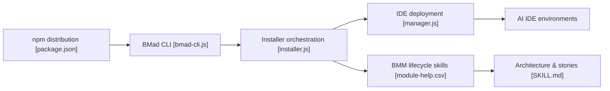

# bmad-code-org/BMAD-METHOD

> AI-driven agile development method: installable skills to scope, design, code and review with a coding assistant.

## The problem
Coding assistants turn unspoken assumptions into code, and context is lost from one conversation to the next.

## What it actually does
It is not an application: it is Markdown skills (brief, PRD, UX, architecture, epics and stories, implementation, code review) that the Node installer writes into the chosen coding tool. The artifacts of one step serve as context for the next. Add-on modules exist (Builder, Test Architect, Game Dev Studio…), as well as web bundles for Gemini Gems and ChatGPT Custom GPTs.

## How it is wired


## Trying it
```bash
npx skills add bmad-code-org/BMAD-METHOD
/plugin marketplace add bmad-code-org/bmad-plugins
codex plugin marketplace add bmad-code-org/bmad-plugins
```
Then, in the coding tool: ask the `bmad` skill to run `bmad setup`, then invoke `bmad-build`.

## Cost and gotchas
The README states "no paid workflow". You need a coding tool that handles skills, Node/npm/Git and `uv`; your assistant subscription or tokens remain at your expense.

## What it is not
It is not a hosted autonomous agent: no backend, no database. It is prompt content run by your assistant, so quality depends on the model used.

## Alternatives
No alternative named in the README.

## For you
Watch: useful to structure AI projects assisted by Claude Code or Codex, but the license is "present but not identified"; check the file before any use in a company.
