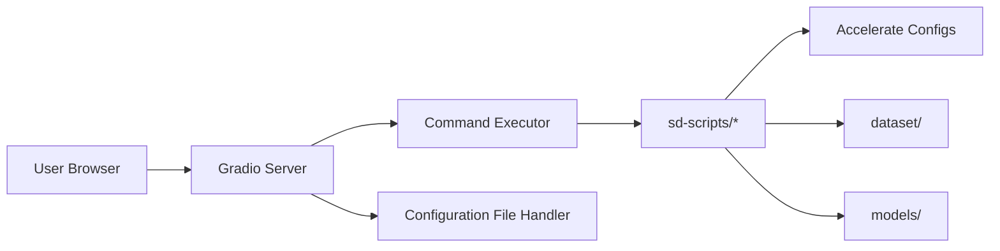

# bmaltais/kohya_ss

> Gradio interface and CLI for training LoRAs and fine-tunes of image diffusion models.

## The problem
Kohya's sd-scripts training scripts expose hundreds of command-line options, hard to tune by hand.

## What it actually does
A Gradio GUI that fills in the parameters and generates/launches the sd-scripts commands via Accelerate.
LoRA, LoHa, LoKr, Dreambooth, fine-tune, Textual Inversion and LECO training on SD 1.5/2.x, SDXL, SD3, Flux.1, Lumina, HunyuanImage.
`config.toml` for default paths; `--headless` mode for remote use; TensorBoard, WD14 captioning.
Installation via uv or pip, Docker, Colab, Runpod.

## How it is wired


## Trying it
```bash
./gui.sh --listen 0.0.0.0 --server_port 7860 --headless
```

## Cost and gotchas
GPU required (or paid Colab/Runpod); installation detailed in separate per-platform guides.
Without `--headless` over SSH, native dialogs can block the training.

## What it is not
Not an image generation tool: it trains, inference happens elsewhere (auto1111 extension).
macOS poorly guaranteed; masked loss not fully tested.

## Alternatives
- camenduru/kohya_ss-colab: the same tool packaged for Colab, maintained by a third party.

## For you
Worth watching only if you fine-tune diffusion models: it is the domain's reference tool, outside a classic data/MLOps profile.
