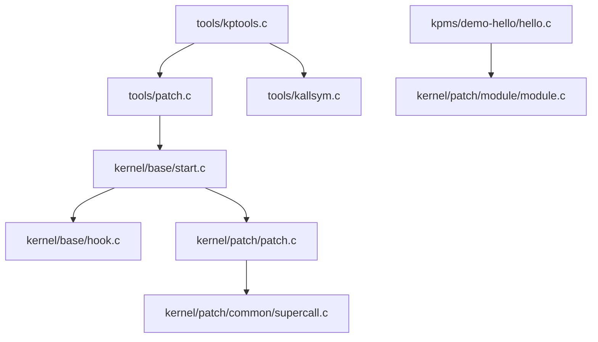

# bmax121/KernelPatch

> Tool to patch and hook the Linux kernel from the kernel image alone, with an SU module for Android.

## The problem
Modifying a kernel without its sources or debug symbols is very difficult.

## What it actually does
The tools in tools/ analyze the kernel image (kptools.c, kallsym.c) and patch it. The code in kernel/base resolves symbols and sets function and system call table hooks. kernel/patch exposes the supercalls and su compatibility, and loads modules (KPM) such as kpms/demo-hello.

## How it is wired

## Trying it
No command in the README; it points to the documentation. The kernel must have `CONFIG_KALLSYMS=y`.

## Cost and gotchas
Free, GPL-2.0. Tampering with the kernel and a device's flash can render it unusable. The README recommends APatch for Android.

## What it is not
Not a mainstream solution: the tool is aimed at kernel developers.

## Alternatives
APatch is cited as the better choice on Android.

## For you
Ignore: kernel hooking and Android rooting, high-risk and outside the data, AI or MLOps scope.
