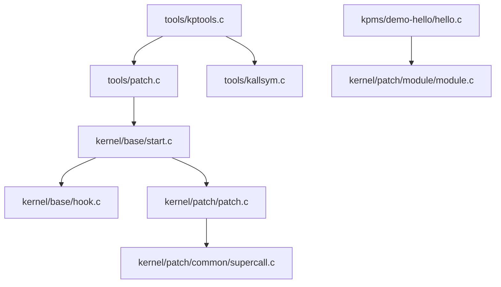

# bmax121/KernelPatch

> Outil pour patcher et accrocher le noyau Linux à partir de la seule image noyau, avec un module SU pour Android.

## Le problème
Modifier un noyau sans ses sources ni ses symboles de débogage est très difficile.

## Ce que ça fait vraiment
Les outils de tools/ analysent l'image noyau (kptools.c, kallsym.c) et la patchent. Le code de kernel/base résout les symboles et pose les hooks de fonctions et de table des appels système. kernel/patch expose les supercalls et la compatibilité su, et charge des modules (KPM) comme kpms/demo-hello.

## Comment c'est branché

## Essayer
Aucune commande dans le README ; il renvoie à la documentation. Le noyau doit avoir `CONFIG_KALLSYMS=y`.

## Coût et pièges
Gratuit, GPL-2.0. Toucher au noyau et au flash d'un appareil peut le rendre inutilisable. Le README recommande APatch pour Android.

## Ce que ce n'est pas
Ce n'est pas une solution grand public : l'outil s'adresse à des développeurs de noyau.

## Alternatives
APatch est cité comme meilleur choix sur Android.

## Pour toi
À ignorer : accrochage du noyau et root Android, aux risques élevés et hors du périmètre data, IA ou MLOps.

