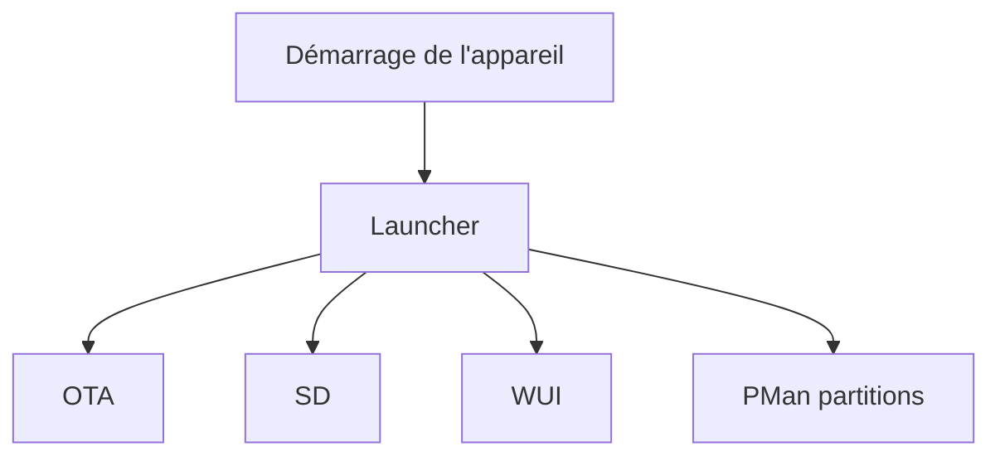

# bmorcelli/Launcher

> Firmware launcher for ESP32 devices (M5Stack, Lilygo, Waveshare), with wireless installation.

## The problem
Switching firmware on an ESP32 device requires a USB cable, esptool and a manual procedure for each trial.

## What it actually does
Firmware that boots on the device and offers OTA (installing binaries from M5Burner or GitHub), SD (file management), WUI (web interface), CFG (settings) and PMan (partition manager: create, format, back up, resize). It then launches the installed program.

## How it is wired
Simplified diagram based on the fiche, no diagram provided.

## Trying it
Not documented on the command line: download `Launcher-{YourDevice}.bin` from the Releases, then flash it with the Flasher, M5Burner, web.esphome.io or esptool.py.

## Cost and gotchas
Free. SD card recommended: SDHC, 32 GB maximum recommended, FAT32 and MBR. UiFlow 1 is incompatible. Plan on having an ESP32 device.

## What it is not
Not an operating system: it only launches and manages other binaries. No support for the old UiFlow 1.

## Alternatives
- M5Burner: tool cited in the README for obtaining and flashing binaries.

## For you
Ignore: a hardware tinkerer's tool, unrelated to your data / AI work.
