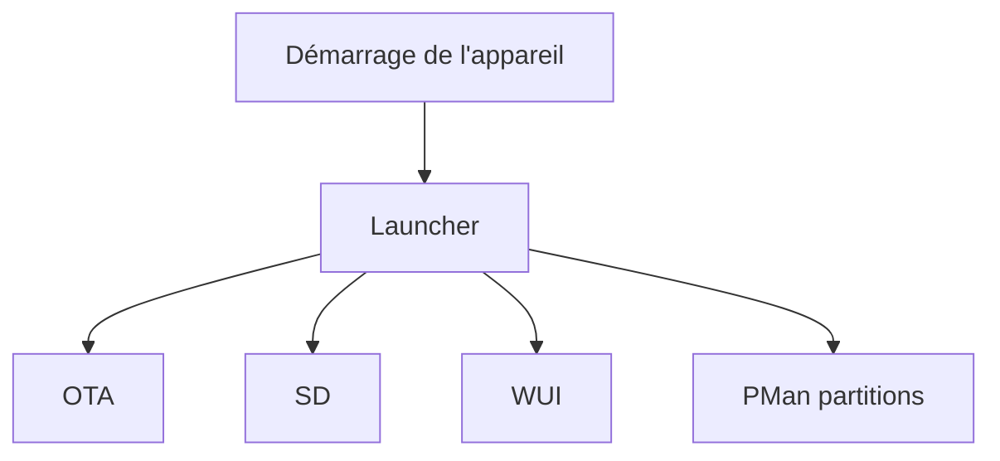

# bmorcelli/Launcher

> Lanceur de micrologiciels pour appareils ESP32 (M5Stack, Lilygo, Waveshare), avec installation sans fil.

## Le problème
Changer de micrologiciel sur un appareil ESP32 exige un câble USB, esptool et une manipulation à chaque essai.

## Ce que ça fait vraiment
Un micrologiciel qui démarre sur l'appareil et propose OTA (installation de binaires depuis M5Burner ou GitHub), SD (gestion de fichiers), WUI (interface web), CFG (réglages) et PMan (gestionnaire de partitions : créer, formater, sauvegarder, redimensionner). Il lance ensuite le programme installé.

## Comment c'est branché
Schéma simplifié d'après la fiche, sans diagramme fourni.

## Essayer
Non documenté en ligne de commande : télécharger `Launcher-{YourDevice}.bin` depuis les Releases, puis le flasher avec le Flasher, M5Burner, web.esphome.io ou esptool.py.

## Coût et pièges
Gratuit. Carte SD conseillée : SDHC, 32 Go maximum recommandés, FAT32 et MBR. UiFlow 1 est incompatible. Prévoir un appareil ESP32.

## Ce que ce n'est pas
Pas un système d'exploitation : il ne fait que lancer et gérer d'autres binaires. Pas de support de l'ancien UiFlow 1.

## Alternatives
- M5Burner : outil cité dans le README pour obtenir et flasher des binaires.

## Pour toi
À ignorer : outil de bidouilleur matériel, sans lien avec ton travail data / IA.

