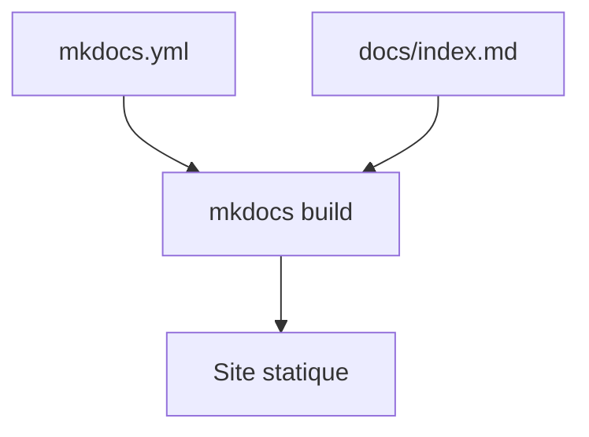

# bnb-chain/bnb-chain.github.io

> Source of the BNB Chain developer documentation site, built with MkDocs Material.

## The problem
BNB Chain developers need a single, versioned, publishable documentation.

## What it actually does
The README is minimal: it describes an MkDocs Material site with `mkdocs.yml` and a `docs/` folder. BNB Chain's technical content is not summarized there.

## How it is wired

Simplified diagram based on the sheet, no diagram provided.

## Trying it
```bash
pip install mkdocs-material
pip install mkdocs-video
pip install mkdocs-redirects
pip install mkdocs-awesome-pages-plugin==2.10.1
mkdocs serve
mkdocs build
```

## Cost and gotchas
Free. No license declared: do not reuse anything without permission. More than 130 open issues.

## What it is not
Not a tool or a library: the repository contains the documentation site, not the chain's software. Insufficient material to judge further.

## Alternatives
No alternative named in the README.

## For you
Ignore: it is a content repository for a blockchain, unrelated to data, AI or MLOps work, and without a license.
