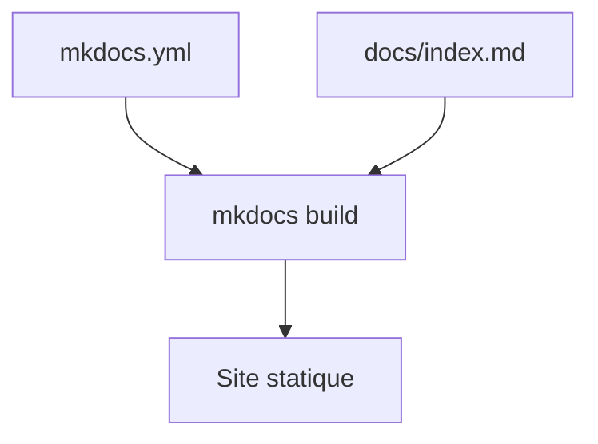

# bnb-chain/bnb-chain.github.io

> Source du site de documentation des développeurs BNB Chain, construit avec MkDocs Material.

## Le problème
Les développeurs BNB Chain ont besoin d'une documentation unique, versionnée et publiable.

## Ce que ça fait vraiment
Le README est minimal : il décrit un site MkDocs Material avec `mkdocs.yml` et un dossier `docs/`. Le contenu technique de BNB Chain n'y est pas résumé.

## Comment c'est branché

Schéma simplifié d'après la fiche, sans diagramme fourni.

## Essayer
```bash
pip install mkdocs-material
pip install mkdocs-video
pip install mkdocs-redirects
pip install mkdocs-awesome-pages-plugin==2.10.1
mkdocs serve
mkdocs build
```

## Coût et pièges
Gratuit. Aucune licence déclarée : ne rien réutiliser sans accord. Plus de 130 issues ouvertes.

## Ce que ce n'est pas
Pas un outil ni une bibliothèque : le dépôt contient le site de documentation, pas le logiciel de la chaîne. Matière insuffisante pour juger plus.

## Alternatives
Aucune alternative nommée dans le README.

## Pour toi
À ignorer : c'est un dépôt de contenu pour une blockchain, sans lien avec un travail data, IA ou MLOps, et sans licence.

