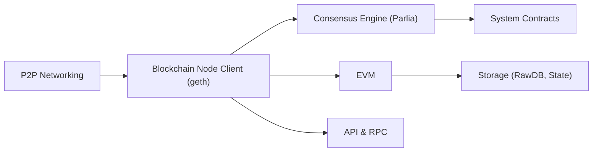

# bnb-chain/bsc

> BNB Smart Chain node client, a go-ethereum fork, for node operators and validators.

## The problem
Taking part in the EVM-compatible BNB Smart Chain requires a full client with its own consensus.

## What it actually does
Modified `geth` client: Parlia consensus (Proof of Staked Authority, 21 validators), system contracts for staking and slashing, JSON-RPC over HTTP, WebSocket and IPC. It also ships `clef`, `devp2p`, `abigen`, `bootnode`, `evm` and `rlpdump`.

## How it is wired


## Trying it
```bash
make geth
./geth --config ./config.toml --datadir ./node --cache 8000 --rpc.allow-unprotected-txs --history.transactions 0
```
The README also details downloading the binaries, the configs and the snapshot.

## Cost and gotchas
Full mainnet node: 3 TB of SSD, 16 cores and 64 GB of RAM. Opening HTTP/WS exposes the node to attacks.

## What it is not
Not a contract development library. The LGPL-3.0 license imposes redistribution obligations.

## Alternatives
No alternative named in the README (go-ethereum is cited as the base of the fork).

## For you
Ignore for a data/AI profile: the heavy infrastructure is only justified if you run a BSC node.
