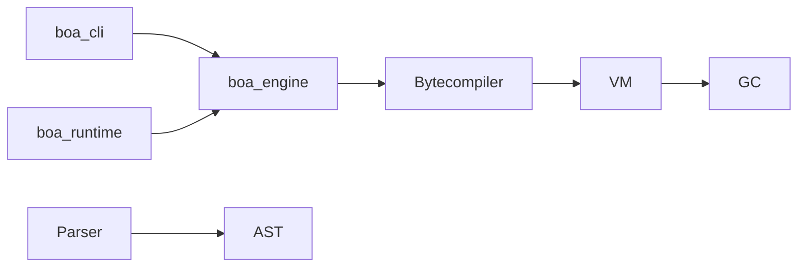

# boa-dev/boa

> JavaScript engine written in Rust, embeddable in a Rust application, for systems developers.

## The problem
Embedding JavaScript in a Rust program without depending on an engine written in C++.

## What it actually does
Source code is parsed into an AST, compiled to bytecode, then run by a virtual machine within a context, with a dedicated garbage collector. It covers more than 90% of the ECMAScript specification according to the README. It offers a CLI, a REPL, a Wasm target and web APIs in `boa_runtime`.

## How it is wired


## Trying it
```bash
cargo run -- test.js
cargo run --release -p boa_cli -- bench-v8/combined.js
```

## Cost and gotchas
Free. Cargo required; the `wasm32-unknown-unknown` target needs the `js` feature and a `RUSTFLAGS` setting.

## What it is not
Not a replacement for V8 or Node: the README calls itself experimental and treats any JavaScript that fails as a bug.

## Alternatives
No alternative named in the README.

## For you
Ignore: a JavaScript engine in Rust, useful only if you must run JS inside a Rust binary.
