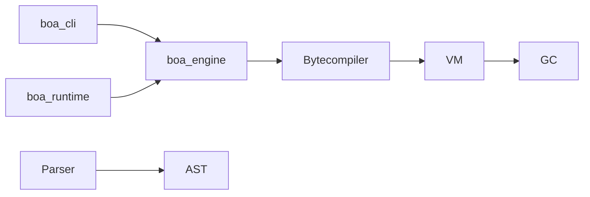

# boa-dev/boa

> Moteur JavaScript écrit en Rust, intégrable dans une application Rust, pour développeurs systèmes.

## Le problème
Embarquer du JavaScript dans un programme Rust sans dépendre d'un moteur écrit en C++.

## Ce que ça fait vraiment
Le code source est analysé en AST, compilé en bytecode puis exécuté par une machine virtuelle dans un contexte, avec un ramasse-miettes dédié. Il couvre plus de 90 % de la spécification ECMAScript selon le README. Il offre une CLI, un REPL, une cible Wasm et des API web dans `boa_runtime`.

## Comment c'est branché


## Essayer
```bash
cargo run -- test.js
cargo run --release -p boa_cli -- bench-v8/combined.js
```

## Coût et pièges
Gratuit. Cargo requis ; la cible `wasm32-unknown-unknown` demande la fonctionnalité `js` et un réglage de `RUSTFLAGS`.

## Ce que ce n'est pas
Ce n'est pas un remplaçant de V8 ou de Node : le README se dit expérimental et tout JavaScript qui échoue est considéré comme un bogue.

## Alternatives
Aucune alternative nommée dans le README.

## Pour toi
À ignorer : moteur JavaScript en Rust, utile seulement si tu dois exécuter du JS dans un binaire Rust.

