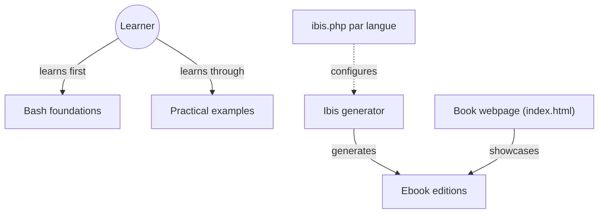

# bobbyiliev/introduction-to-bash-scripting

> Open-source ebook introducing Bash scripting for developers, administrators and DevOps.

## The problem
Automating repetitive command-line tasks requires mastering the basics of Bash, scattered across many sources.

## What it actually does
A book in chapters: thirteen chapters of fundamentals (variables, arrays, conditions, loops, functions), then practical cases such as jq, the Cloudflare API, NGINX and Apache log analysis, sending e-mails or a password generator. The PDF and ePub editions can be downloaded, and the repository contains translations.

## How it is wired


## Trying it
```bash
# Aucune commande dans le README : télécharger l'ebook (mode sombre, mode clair ou ePub).
```

## Cost and gotchas
Free, MIT license. The README contains DigitalOcean referral links and sponsor mentions. The PDF is generated with the PHP tool Ibis.

## What it is not
It is not a tool or a library: it is course material. It covers neither Python nor modern pipeline automation.

## Alternatives
The README cites other ebooks by the author (Docker, Git and GitHub, SQL, Terraform, Linux).

## For you
Worth watching: useful for filling gaps in shell basics, but with nothing specific to data or AI.
