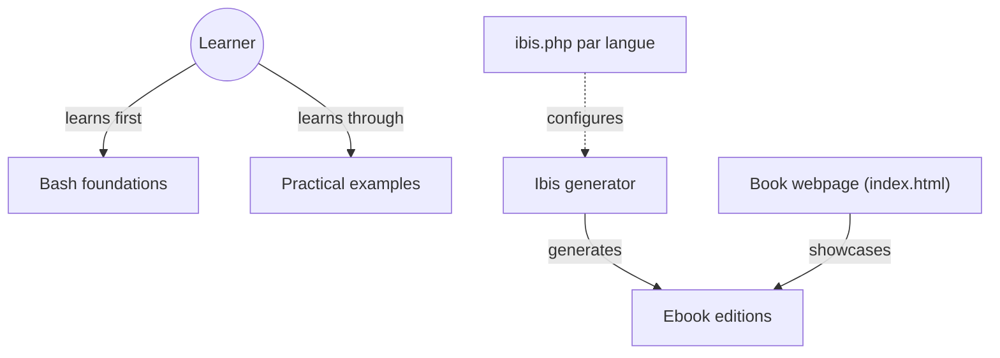

# bobbyiliev/introduction-to-bash-scripting

> Ebook open source d'introduction au scripting Bash pour développeurs, administrateurs et DevOps.

## Le problème
Automatiser des tâches répétitives en ligne de commande demande de maîtriser les bases de Bash, dispersées dans de nombreuses sources.

## Ce que ça fait vraiment
Un livre en chapitres : treize chapitres de fondations (variables, tableaux, conditions, boucles, fonctions), puis des cas pratiques comme jq, l'API Cloudflare, l'analyse de logs NGINX et Apache, l'envoi d'e-mails ou un générateur de mots de passe. Les éditions PDF et ePub se téléchargent, et le dépôt contient des traductions.

## Comment c'est branché


## Essayer
```bash
# Aucune commande dans le README : télécharger l'ebook (mode sombre, mode clair ou ePub).
```

## Coût et pièges
Gratuit, licence MIT. Le README contient des liens de parrainage DigitalOcean et des mentions de sponsors. Le PDF se génère avec l'outil PHP Ibis.

## Ce que ce n'est pas
Ce n'est pas un outil ni une bibliothèque : c'est un support de cours. Il ne couvre ni Python ni l'automatisation moderne de pipelines.

## Alternatives
Le README cite d'autres ebooks de l'auteur (Docker, Git et GitHub, SQL, Terraform, Linux).

## Pour toi
À surveiller : utile pour combler des bases en shell, mais sans rien de propre à la data ou à l'IA.

