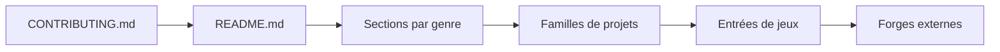

# bobeff/open-source-games

> List, sorted by genre, of open source video games and free reimplementations of commercial games.

## The problem
Finding free games and reimplementation engines (Doom, OpenRCT2, OpenTTD…) scattered across several forges.

## What it actually does
A Markdown README organized by genre (strategy, FPS, RPG, racing…), with for each entry a short description and a link to the source repository (GitHub, GitLab, Codeberg, SourceForge). No application code: only `scripts/coauthor.py` is used, by contributors. The list ends with other reference lists.

## How it is wired

## Trying it
No command: the list is read in the README.

## Cost and gotchas
Free. Each listed game has its own license, often with original data to supply; some links may be dead, maintenance is manual.

## What it is not
It is neither a launcher nor a catalog of binaries: the repository contains no game. The links point to unaudited third-party projects.

## Alternatives
The README itself points to other lists: Awesome Open Source Games, Awesome Game Remakes, Libre Game Wiki.

## For you
Ignore: a hobby list unrelated to data/AI/MLOps work, except to look for a game environment to use in reinforcement learning; the README does not cover that topic.
