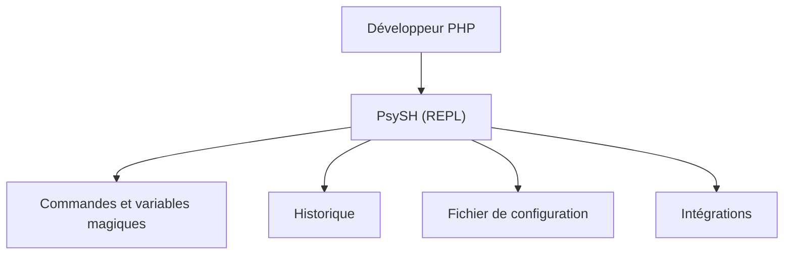

# bobthecow/psysh

> Interactive console, debugger and REPL for PHP, aimed at PHP developers.

## The problem
Testing a line of PHP or inspecting a runtime state forces you to write a throwaway script.

## What it actually does
The README mostly provides a table of contents: installation, usage (magic variables, history, shell integration), commands, configuration (options, themes), integrations. The details are in the external manual, not reproduced here.

## How it is wired
Simplified diagram based on the fiche, no diagram provided.



## Trying it
```bash
# Aucune commande documentée dans le README (renvoi au manuel sur psysh.org).
```

## Cost and gotchas
Free. A PHP environment is needed, absent from the list of prerequisites: put `[aucun]` here, the real need is PHP. The README gives neither a command nor a required version.

## What it is not
Not a data science tool: it serves PHP only. The README alone does not allow judging the features: everything points to the manual.

## Alternatives
No alternative named in the README.

## For you
Ignore for a data / AI / MLOps profile: it is a PHP REPL, outside your Python stack, unless you maintain PHP code.
