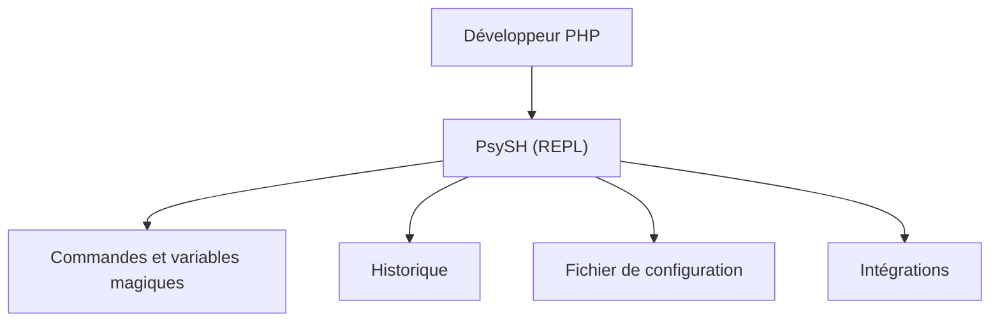

# bobthecow/psysh

> Console interactive, débogueur et REPL pour PHP, destiné aux développeurs PHP.

## Le problème
Tester une ligne de PHP ou inspecter un état d'exécution oblige à écrire un script jetable.

## Ce que ça fait vraiment
Le README fournit surtout une table des matières : installation, usage (variables magiques, historique, intégration au shell), commandes, configuration (options, thèmes), intégrations. Le détail est dans le manuel externe, non reproduit ici.

## Comment c'est branché
Schéma simplifié d'après la fiche, sans diagramme fourni.



## Essayer
```bash
# Aucune commande documentée dans le README (renvoi au manuel sur psysh.org).
```

## Coût et pièges
Gratuit. Il faut un environnement PHP, absent des prérequis de la liste : mets `[aucun]` ici, le besoin réel est PHP. Le README ne donne ni commande ni version requise.

## Ce que ce n'est pas
Pas un outil de data science : il sert à PHP uniquement. Le README seul ne permet pas de juger les fonctions : tout renvoie au manuel.

## Alternatives
Aucune alternative nommée dans le README.

## Pour toi
À ignorer pour un profil data / IA / MLOps : c'est un REPL PHP, hors de ta pile Python, sauf si tu maintiens du code PHP.

