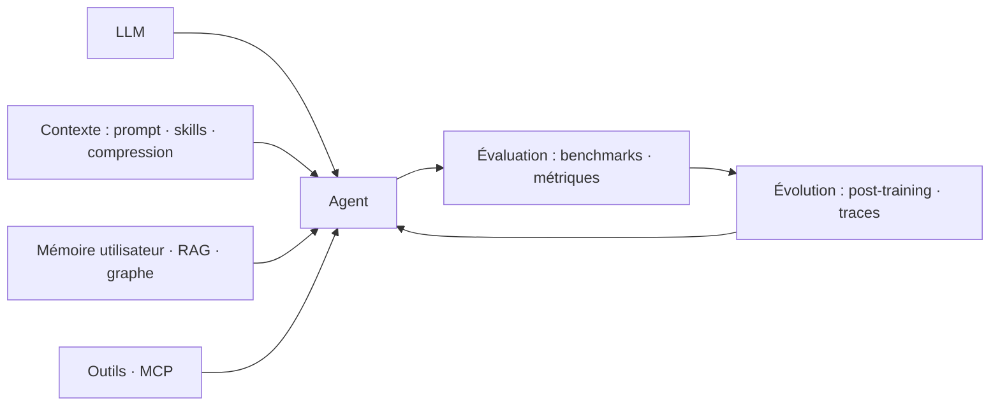

# bojieli/ai-agent-book

> A comprehensive book covering artificial intelligence agents, with 109 reproducible experiments.

## The problem
The resources on agents jump from the concept to the demo. Without a complete chain – including context, memory, tools, evaluation, and post-training – we are simply assembling things without understanding the trade-offs.

## What it actually does
Un comprehensive formula is presented across ten chapters: context engineering (KV cache, Agent Skills, compression), user memory and RAG, tools and MCP protocol, code agents, extending observation and action spaces (asynchronous, voice, computer use, robotics), evaluation, post-training (SFT vs RL), continuous evolution, and multi-agent collaboration. 109 associated experiments are included, available in PDF/EPUB format in 15 languages, with online reading capabilities including highlighting and note-taking.

## How it is wired


## Trying it
```bash
uv sync --locked --extra ch1
uv run python chapter1/context/main.py
cd book && bash build_pdf.sh
```

## Cost and gotchas
Apache 2.0, free book and code. Experiments that require a model need at least one vendor key (Kimi, GLM, DeepSeek, SiliconFlow, OpenRouter…); the README highlights a reseller sponsor of APIs. Python 3.11–3.13, some experiments in chapter 8 require 3.12+. 22 external repositories need to be cloned manually for chapters 6, 7, 8, and 10, and are pinned to immutable SHA hashes.

## What it is not
The README is clear: cloning the source code or successfully installing it does not equate to running an experiment – the actual status is recorded in `docs/EXPERIMENT_STATUS.md`. The accompanying code is generated by a code generator and is not reviewed line by line by the author. The reference text is in Chinese; other languages are community translations, which may be delayed.

## Alternatives
- bojieli/ai-infra-book: the companion volume, covering training and inference infrastructure.

## For you
To use: The table of contents alone provides a robust framework for auditing any agent you create or evaluate.
