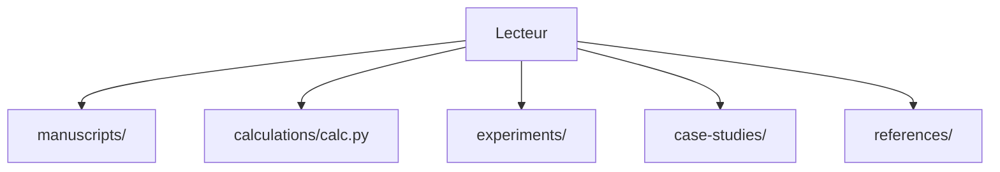

# bojieli/ai-infra-book

> Book on AI infrastructure with resource calculations and experiments, for engineers and students.

## The problem
Understanding why a model is slow or expensive requires linking model, memory, bandwidth and network.

## What it actually does
Twelve chapters: models, inference and training workloads, accelerators, operators, superpods, networking, optimization and distributed inference. The derivations start from hardware constraints. A calc.py tool recomputes the book's figures (Python 3.10 standard library, no GPU or weights). English, Traditional Chinese and Russian editions by the community. The text is still a first draft.

## How it is wired


## Trying it
```bash
git clone https://github.com/bojieli/ai-infra-book.git
cd ai-infra-book
python3 calculations/calc.py models
python3 calculations/calc.py forward --model qwen3-8b --tokens 8192 --format md
```

## Cost and gotchas
Free. Git LFS weighs about 20 GB but is disabled by default. Some experiments require a GPU. The source text is in Chinese, the English is a community translation.

## What it is not
Not a finalized manual: the README speaks of a first draft under revision. Not a library to integrate.

## Alternatives
No alternative named in the README.

## For you
Adopt: directly useful reading for sizing GPUs, KV cache and inference costs, with a calculator to check your orders of magnitude.
