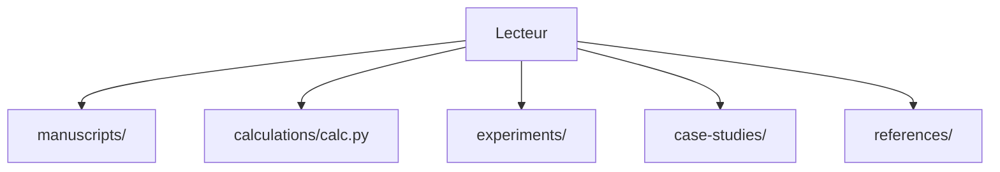

# bojieli/ai-infra-book

> Livre sur l'infrastructure IA avec calculs de ressources et expériences, pour ingénieurs et étudiants.

## Le problème
Comprendre pourquoi un modèle est lent ou coûteux exige de relier modèle, mémoire, bande passante et réseau.

## Ce que ça fait vraiment
Douze chapitres : modèles, charges d'inférence et d'entraînement, accélérateurs, opérateurs, superpods, réseau, optimisation et inférence distribuée. Les dérivations partent des contraintes matérielles. Un outil calc.py recalcule les chiffres du livre (bibliothèque standard Python 3.10, ni GPU ni poids). Éditions anglaise, chinoise traditionnelle et russe par la communauté. Le texte est encore une première version.

## Comment c'est branché


## Essayer
```bash
git clone https://github.com/bojieli/ai-infra-book.git
cd ai-infra-book
python3 calculations/calc.py models
python3 calculations/calc.py forward --model qwen3-8b --tokens 8192 --format md
```

## Coût et pièges
Gratuit. Git LFS pèse environ 20 Go mais est désactivé par défaut. Certaines expériences demandent un GPU. Le texte source est en chinois, l'anglais est une traduction communautaire.

## Ce que ce n'est pas
Pas un manuel finalisé : le README parle d'une première version en révision. Pas une librairie à intégrer.

## Alternatives
Aucune alternative nommée dans le README.

## Pour toi
À adopter : lecture directement utile pour dimensionner GPU, KV cache et coûts d'inférence, avec un calculateur pour vérifier tes ordres de grandeur.

