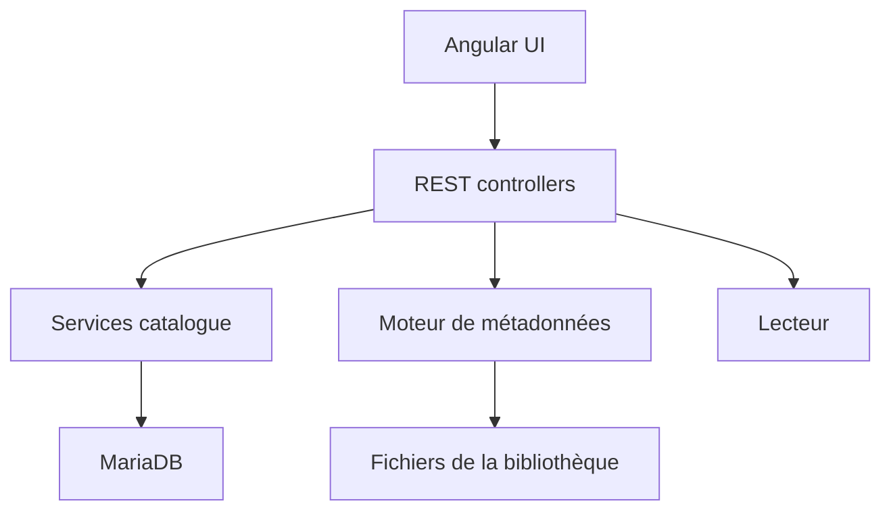

# booklore-app/booklore

> Self-hosted application to organize, read, annotate and sync your book library.

## The problem
A collection of digital books is scattered across files, e-readers and third-party services, with no clean metadata.

## What it actually does
Spring Boot API and Angular interface with MariaDB. Smart shelves, automatic metadata (Google Books, Open Library, Amazon), built-in reader for PDF, EPUB and comics, Kobo, OPDS and KOReader sync, multi-user with OIDC, watched BookDrop folder and email sending. The project is moving to maintenance: BookOrbit is its successor.

## How it is wired


## Trying it
```bash
docker compose up -d
```
After creating the `.env` and `docker-compose.yml` from the README, open http://localhost:6060.

## Cost and gotchas
Free. Docker and MariaDB required. Network storage (NAS, NFS, SMB) is not supported: use `DISK_TYPE=NETWORK`. 563 open issues.

## What it is not
Not the active project: BookOrbit is the successor and BookLore stays in maintenance. Not a tool to expose without security settings.

## Alternatives
- BookOrbit: official successor, actively developed.

## For you
Worth watching: interesting for personal self-hosting, but in maintenance; aim for BookOrbit instead.
