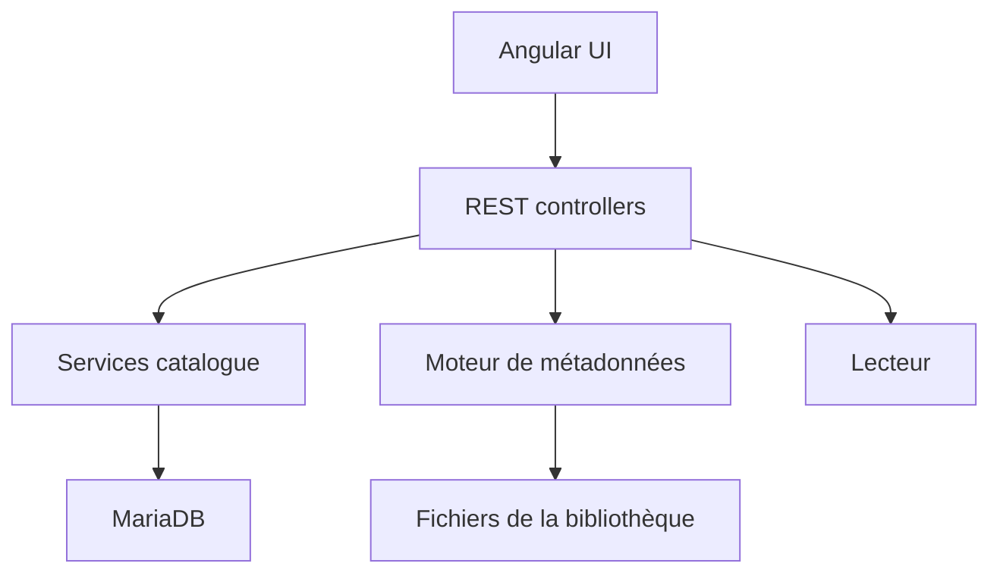

# booklore-app/booklore

> Application auto-hébergée pour organiser, lire, annoter et synchroniser sa bibliothèque de livres.

## Le problème
Une collection de livres numériques est dispersée entre fichiers, liseuses et services tiers, sans métadonnées propres.

## Ce que ça fait vraiment
API Spring Boot et interface Angular avec MariaDB. Étagères intelligentes, métadonnées automatiques (Google Books, Open Library, Amazon), lecteur intégré pour PDF, EPUB et bandes dessinées, synchronisation Kobo, OPDS et KOReader, multi-utilisateurs avec OIDC, dossier BookDrop surveillé et envoi par e-mail. Le projet passe en maintenance : BookOrbit est son successeur.

## Comment c'est branché


## Essayer
```bash
docker compose up -d
```
Après création du `.env` et du `docker-compose.yml` du README, ouvrir http://localhost:6060.

## Coût et pièges
Gratuit. Docker et MariaDB requis. Stockage réseau (NAS, NFS, SMB) non pris en charge : utiliser `DISK_TYPE=NETWORK`. 563 issues ouvertes.

## Ce que ce n'est pas
Pas le projet actif : BookOrbit est le successeur et BookLore reste en maintenance. Pas un outil à exposer sans réglages de sécurité.

## Alternatives
- BookOrbit : successeur officiel, développement actif.

## Pour toi
Surveiller : intéressant en auto-hébergement personnel, mais en maintenance ; vise plutôt BookOrbit.

