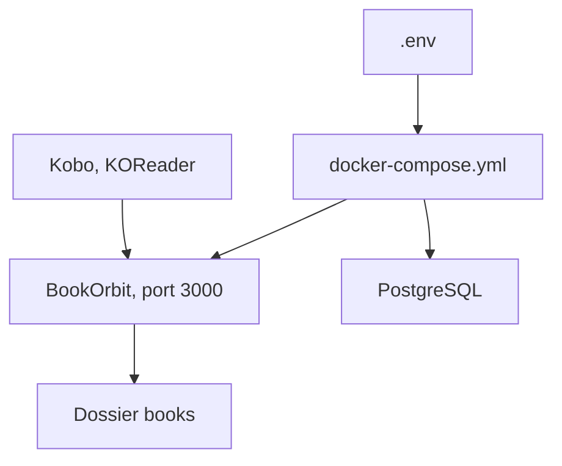

# bookorbit/bookorbit

> Self-hosted library for ebooks, PDFs, audiobooks and comics, with reading sync across devices.

## The problem
Books, audio and comics are scattered, and reading progress doesn't follow from one device to another.

## What it actually does
Web server with built-in readers (EPUB, PDF, CBZ, M4B...), KOReader plugin, Kobo sync, OPDS and send-to-Kindle. It aggregates metadata from 14 providers, handles multiple users with SSO (OIDC) and pushes progress to Hardcover, Readwise and StoryGraph. Native iPhone and Apple Watch apps.

## How it is wired

Simplified diagram based on the sheet, no diagram provided.

## Trying it
```bash
mkdir bookorbit && cd bookorbit
mkdir -p books data/app data/postgres
curl -fsSLo .env https://raw.githubusercontent.com/bookorbit/bookorbit/main/.env.example
curl -fsSLo docker-compose.yml https://raw.githubusercontent.com/bookorbit/bookorbit/main/docker-compose.yml
docker compose up -d
```

## Cost and gotchas
Free. Three secrets to generate (POSTGRES_PASSWORD, JWT_SECRET, SETUP_BOOTSTRAP_TOKEN). Badly set PUID and PGID cause permission errors on the first scan.

## What it is not
Not a stable API: the README warns that the API is not a public surface and that third-party clients are not guaranteed. The Android app is in closed testing. 625 open issues for a repo from May 2026.

## Alternatives
No alternative named in the README.

## For you
Ignore on the data/AI side: it is a personal reading tool, unrelated to your work.
