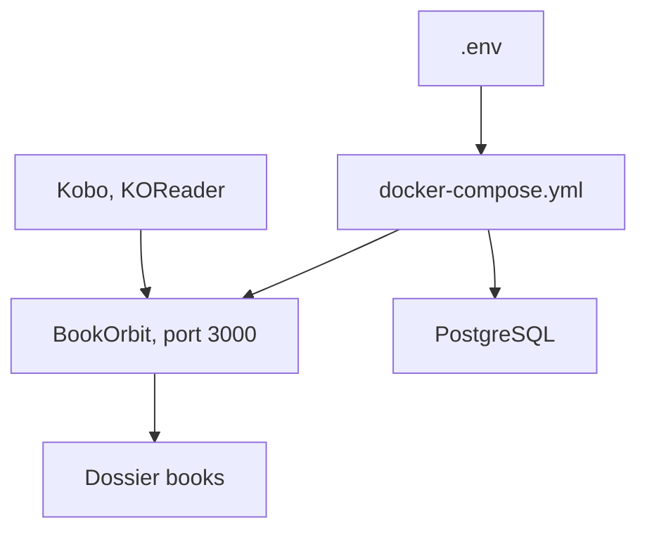

# bookorbit/bookorbit

> Bibliothèque auto-hébergée pour ebooks, PDF, livres audio et BD, avec synchronisation de lecture entre appareils.

## Le problème
Livres, audio et BD sont éparpillés, et la progression de lecture ne suit pas d'un appareil à l'autre.

## Ce que ça fait vraiment
Serveur web avec lecteurs intégrés (EPUB, PDF, CBZ, M4B...), plugin KOReader, synchronisation Kobo, OPDS et envoi vers Kindle. Il agrège des métadonnées de 14 fournisseurs, gère plusieurs utilisateurs avec SSO (OIDC) et pousse la progression vers Hardcover, Readwise et StoryGraph. Applis natives iPhone et Apple Watch.

## Comment c'est branché

Schéma simplifié d'après la fiche, sans diagramme fourni.

## Essayer
```bash
mkdir bookorbit && cd bookorbit
mkdir -p books data/app data/postgres
curl -fsSLo .env https://raw.githubusercontent.com/bookorbit/bookorbit/main/.env.example
curl -fsSLo docker-compose.yml https://raw.githubusercontent.com/bookorbit/bookorbit/main/docker-compose.yml
docker compose up -d
```

## Coût et pièges
Gratuit. Trois secrets à générer (POSTGRES_PASSWORD, JWT_SECRET, SETUP_BOOTSTRAP_TOKEN). PUID et PGID mal réglés causent les erreurs de permission au premier scan.

## Ce que ce n'est pas
Pas une API stable : le README prévient que l'API n'est pas une surface publique et que les clients tiers ne sont pas garantis. L'appli Android est en test fermé. 625 issues ouvertes pour un dépôt de mai 2026.

## Alternatives
Aucune alternative nommée dans le README.

## Pour toi
À ignorer côté data/IA : c'est un outil de lecture personnelle, sans lien avec ton métier.

