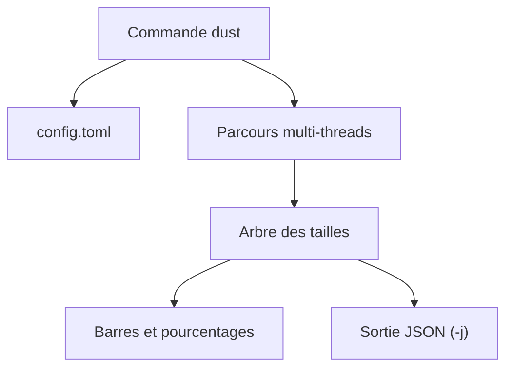

# bootandy/dust

> Rust alternative to `du` that shows at a glance where disk space goes.

## The problem
Finding out what fills a disk means chaining `du`, `sort` and `head`.

## What it actually does
Displays the biggest folders and files as a tree with percentage bars, adapting to the terminal height. Filters by regex, minimum size, file type, depth, JSON output. Does not count hard links twice. Configuration in a TOML file.

## How it is wired
Simplified diagram based on the sheet, no diagram provided.



## Trying it
```bash
curl -sSfL https://raw.githubusercontent.com/bootandy/dust/refs/heads/master/install.sh | sh
cargo install du-dust
dust -n 30
dust -d 3
```

## Cost and gotchas
Free. The install script is run straight from curl: read it first. On Windows MSVC, VCRUNTIME140.dll is required.

## What it is not
It is not a cleanup manager: it deletes nothing. It is not interactive like ncdu.

## Alternatives
- NCDU, dutree, dua, pdu, dirstat-rs: listed in the README, with no numerical comparison here.

## For you
Adopt: to spot in a few seconds the checkpoints, caches and datasets that saturate a training machine.
