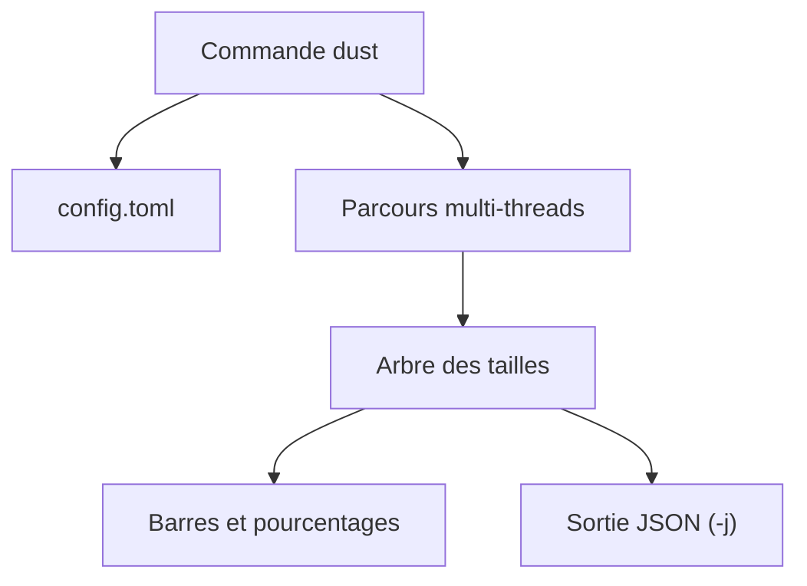

# bootandy/dust

> Alternative à `du` en Rust, qui montre d'un coup d'œil où va l'espace disque.

## Le problème
Savoir ce qui remplit un disque oblige à enchaîner `du`, `sort` et `head`.

## Ce que ça fait vraiment
Affiche en arbre les plus gros dossiers et fichiers avec des barres de pourcentage, en s'adaptant à la hauteur du terminal. Filtres par regex, taille minimale, type de fichier, profondeur, sortie JSON. Ne compte pas deux fois les liens physiques. Configuration dans un fichier TOML.

## Comment c'est branché
Schéma simplifié d'après la fiche, sans diagramme fourni.



## Essayer
```bash
curl -sSfL https://raw.githubusercontent.com/bootandy/dust/refs/heads/master/install.sh | sh
cargo install du-dust
dust -n 30
dust -d 3
```

## Coût et pièges
Gratuit. Le script d'installation est exécuté directement depuis curl : à lire avant. Sous Windows MSVC, il faut VCRUNTIME140.dll.

## Ce que ce n'est pas
Ce n'est pas un gestionnaire de nettoyage : il n'efface rien. Il n'est pas interactif comme ncdu.

## Alternatives
- NCDU, dutree, dua, pdu, dirstat-rs : listés dans le README, sans comparaison chiffrée ici.

## Pour toi
À adopter : pour repérer en quelques secondes les checkpoints, caches et datasets qui saturent une machine d'entraînement.

