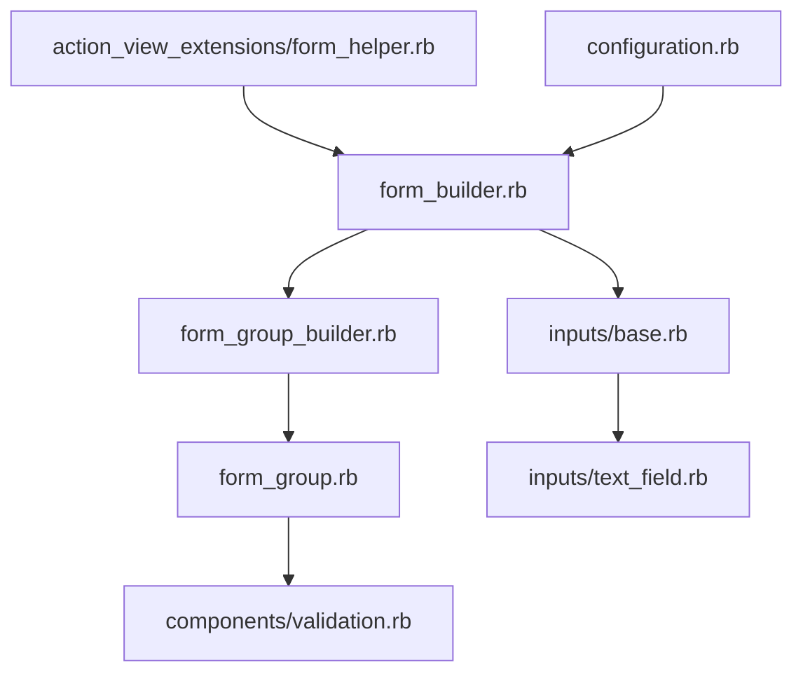

# bootstrap-ruby/bootstrap_form

> Rails form builder that generates Bootstrap 5 markup: labels, help text and errors.

## The problem
Writing the Bootstrap markup of each field by hand is slow and error-prone.

## What it actually does
The `bootstrap_form_for`, `bootstrap_form_with` and `bootstrap_form_tag` helpers instantiate a FormBuilder that wraps each field in a form group (label, help text, validation message, required attribute). Options for prefixed fields, horizontal forms and accessible checkbox groups.

## How it is wired


## Trying it
```bash
rails new --javascript=esbuild --css=bootstrap <application-name>
bundle install
```
Gemfile line: `gem "bootstrap_form", "~> 5.6"`.

## Cost and gotchas
Free. Requires Ruby 3.2+, Rails 7.2+ and Bootstrap 5 already installed (importmaps not supported for the recommended path). The provided CSS is only useful for a few helpers.

## What it is not
Does not install Bootstrap and does not handle client-side HTML5 validation, which does not fit well with Rails validation.

## Alternatives
No alternative named in the README.

## For you
Ignore: Ruby on Rails gem, no use in data, AI or MLOps work.
