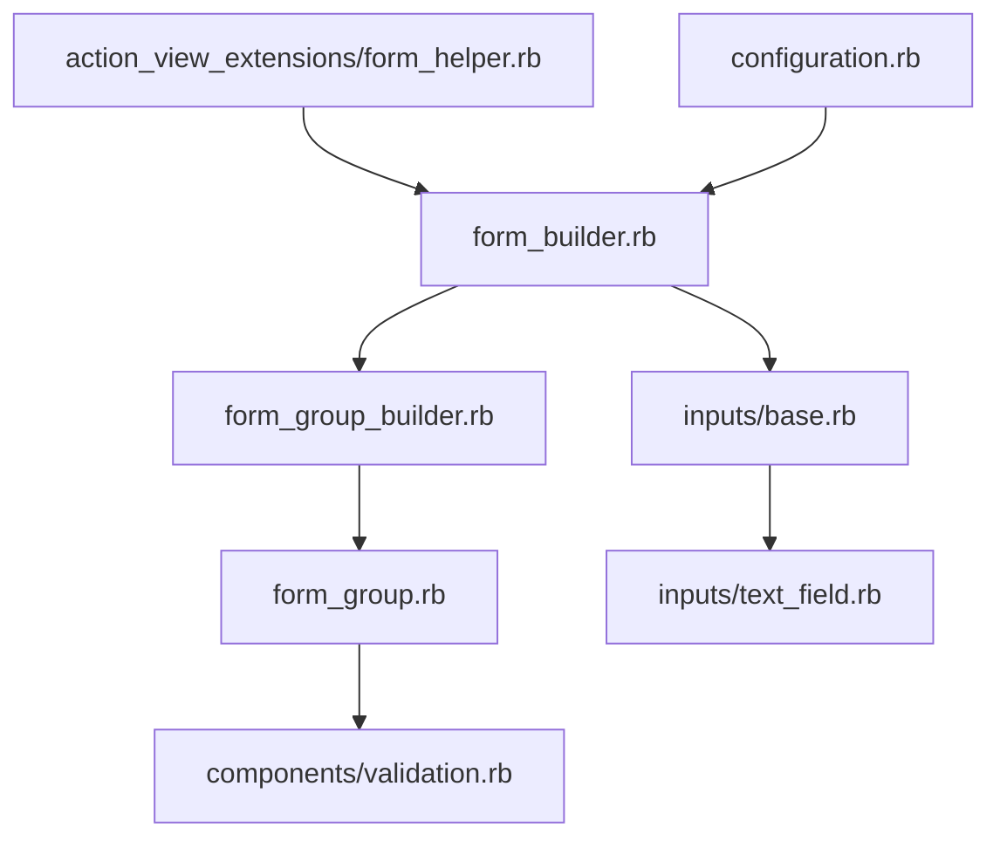

# bootstrap-ruby/bootstrap_form

> Constructeur de formulaires Rails qui génère le balisage Bootstrap 5 : libellés, aides et erreurs.

## Le problème
Écrire à la main le balisage Bootstrap de chaque champ est long et source d'erreurs.

## Ce que ça fait vraiment
Les helpers `bootstrap_form_for`, `bootstrap_form_with` et `bootstrap_form_tag` instancient un FormBuilder qui enveloppe chaque champ dans un groupe de formulaire (label, aide, message de validation, attribut required). Options pour champs préfixés, formulaires horizontaux et groupes de cases à cocher accessibles.

## Comment c'est branché


## Essayer
```bash
rails new --javascript=esbuild --css=bootstrap <application-name>
bundle install
```
Ligne du Gemfile : `gem "bootstrap_form", "~> 5.6"`.

## Coût et pièges
Gratuit. Exige Ruby 3.2+, Rails 7.2+ et Bootstrap 5 déjà installé (importmaps non supporté pour le chemin recommandé). Le CSS fourni n'est utile que pour quelques helpers.

## Ce que ce n'est pas
N'installe pas Bootstrap et ne gère pas la validation HTML5 côté client, qui s'accorde mal avec celle de Rails.

## Alternatives
Aucune alternative nommée dans le README.

## Pour toi
À ignorer : gem Ruby on Rails, sans usage dans un travail data, IA ou MLOps.

