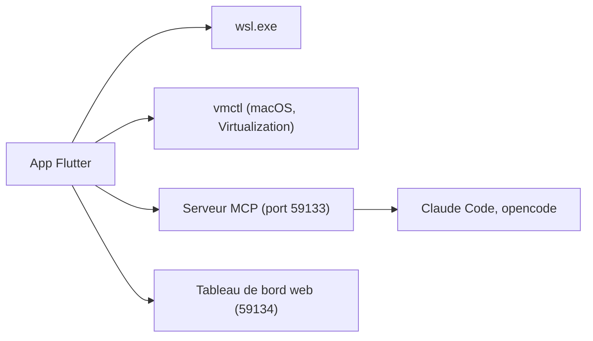

# bostrot/wsl2-distro-manager

> Graphical application to manage WSL distributions on Windows, and virtual machines on macOS.

## The problem
Managing WSL distributions forces you to remember many `wsl.exe` options to copy, move or back up an instance.

## What it actually does
Installs, copies, renames, moves, backs up and deletes distros; edits `.wslconfig`; mounts disks; manages remote instances over SSH. Offers command snippets and packaging as `.wsl`. The paid Pro offer adds an AI assistant, an MCP server and a web dashboard, using your own OpenAI-compatible key.

## How it is wired
Simplified diagram based on the fiche, no diagram provided.



## Trying it
```bash
winget install Bostrot.WSLManager
scoop install extras/wsl2-distro-manager
brew install --cask wsl-manager
```

## Cost and gotchas
The basic features are free; Pro is a one-time purchase. The AI uses your API key and nothing is hosted. The dashboard listens on all interfaces and a published link can run commands.

## What it is not
It is not an AI service: no credits are included. Not a native Linux tool: Windows and macOS only. The license exists but is not identified.

## Alternatives
No alternative named in the README.

## For you
Worth watching: handy if you juggle several WSL distros for your environments, but the MCP server and the dashboard are reserved for Pro.
