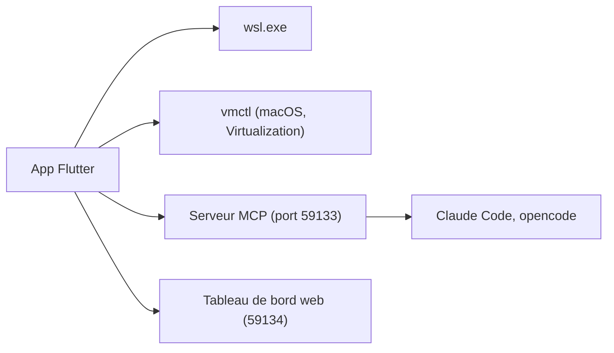

# bostrot/wsl2-distro-manager

> Application graphique pour gérer les distributions WSL sous Windows, et des machines virtuelles sous macOS.

## Le problème
Gérer des distributions WSL oblige à retenir de nombreuses options de `wsl.exe` pour copier, déplacer ou sauvegarder une instance.

## Ce que ça fait vraiment
Installe, copie, renomme, déplace, sauvegarde et supprime des distros ; édite `.wslconfig` ; monte des disques ; gère des instances distantes par SSH. Offre des extraits de commandes et le packaging en `.wsl`. L'offre Pro payante ajoute un assistant IA, un serveur MCP et un tableau de bord web, avec ta propre clé compatible OpenAI.

## Comment c'est branché
Schéma simplifié d'après la fiche, sans diagramme fourni.



## Essayer
```bash
winget install Bostrot.WSLManager
scoop install extras/wsl2-distro-manager
brew install --cask wsl-manager
```

## Coût et pièges
Les fonctions de base sont gratuites ; Pro est un achat unique. L'IA utilise ta clé d'API et rien n'est hébergé. Le tableau de bord écoute sur toutes les interfaces et un lien publié peut exécuter des commandes.

## Ce que ce n'est pas
Ce n'est pas un service IA : aucun crédit n'est inclus. Pas un outil Linux natif : Windows et macOS seulement. La licence existe mais n'est pas identifiée.

## Alternatives
Aucune alternative nommée dans le README.

## Pour toi
À surveiller : pratique si tu jongles avec plusieurs distros WSL pour tes environnements, mais le serveur MCP et le tableau de bord sont réservés à Pro.

