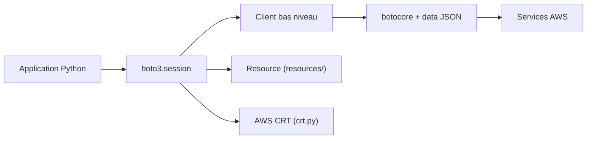

# boto/boto3

> Official Python SDK for Amazon Web Services, to call S3, EC2, DynamoDB and the other services.

## The problem
Calling AWS APIs with hand-signed HTTP is tedious and error-prone.

## What it actually does
A session (`session.py`) loads credentials and region, then builds low-level clients, driven by JSON service models and backed by `botocore`, and object-oriented resources that wrap them. Paginators, waiters and an optional AWS CRT integration are added. Maintained by AWS.

## How it is wired


## Trying it
```bash
python -m venv .venv
. .venv/bin/activate
python -m pip install boto3
```
Then, in Python: `import boto3; s3 = boto3.resource('s3')`.

## Cost and gotchas
The SDK is free, but the services it calls are billed by AWS. Credentials in `~/.aws/credentials` and region in `~/.aws/config`. Python 3.9 support ended on 2026-04-29.

## What it is not
Not a multi-cloud abstraction: it only talks to AWS. The README points to community help and Stack Overflow, with limited support bandwidth.

## Alternatives
No alternative named in the README.

## For you
Adopt: a must for reading and writing on S3 or driving SageMaker from Python, no debate once your infrastructure is on AWS.
