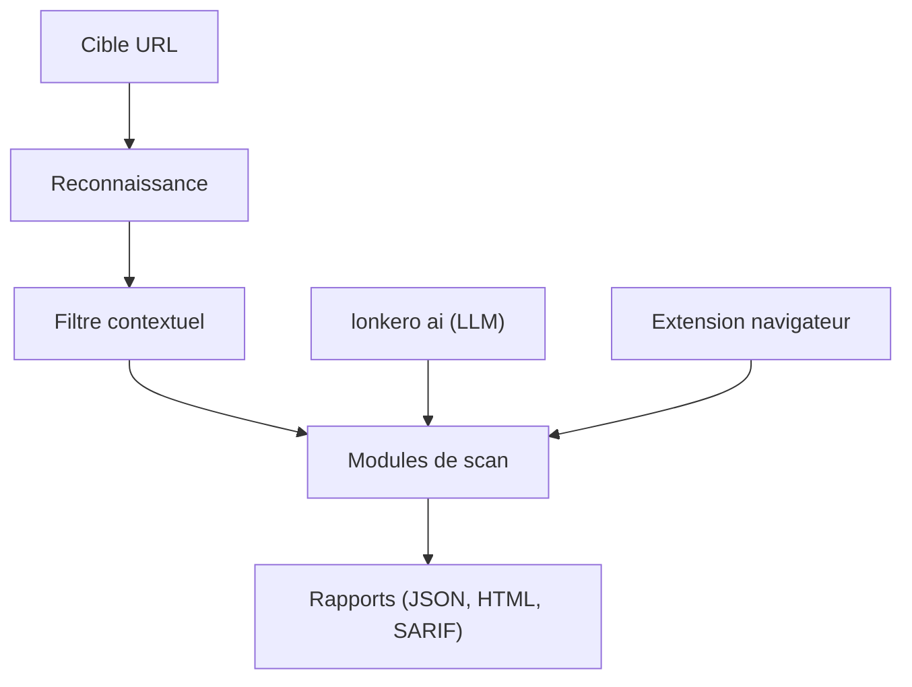

# bountyyfi/lonkero

> Scanner de sécurité web en Rust, avec un mode agent IA qui pilote les modules de test.

## Le problème
Les scanners web génériques lancent des milliers de charges inutiles et produisent beaucoup de faux positifs.

## Ce que ça fait vraiment
Détecte la technologie cible, filtre les paramètres puis exécute plus de cent modules (injections, authentification, API, configuration, chaîne d'approvisionnement). Le mode `lonkero ai` laisse un LLM (Claude ou Ollama local) choisir les modules à lancer. Une extension Chrome et Edge se connecte à la CLI par WebSocket local. Il détecte aussi les injections de prompt cachées dans les README.

## Comment c'est branché
Schéma simplifié d'après la fiche, sans diagramme fourni.



## Essayer
```bash
lonkero scan https://example.com
lonkero scan https://example.com --payload-intensity minimal
export ANTHROPIC_API_KEY=sk-ant-...
lonkero ai https://example.com
```

## Coût et pièges
Le mode IA consomme une clé d'API Anthropic, sauf avec Ollama en local. Le README ne décrit pas l'installation dans la partie fournie. Les chiffres de précision (5 % de faux positifs) sont des affirmations de l'auteur. À lancer uniquement sur des cibles autorisées.

## Ce que ce n'est pas
Pas un outil à lancer sans autorisation écrite : c'est un scanner offensif. Une partie des fonctions (modèle de détection côté serveur) laisse penser à une offre commerciale ; la licence n'est pas identifiée.

## Alternatives
Aucune alternative nommée dans le README.

## Pour toi
À surveiller : intéressant comme exemple d'agent LLM qui pilote des outils de sécurité, mais licence et modèle économique à clarifier avant usage.

