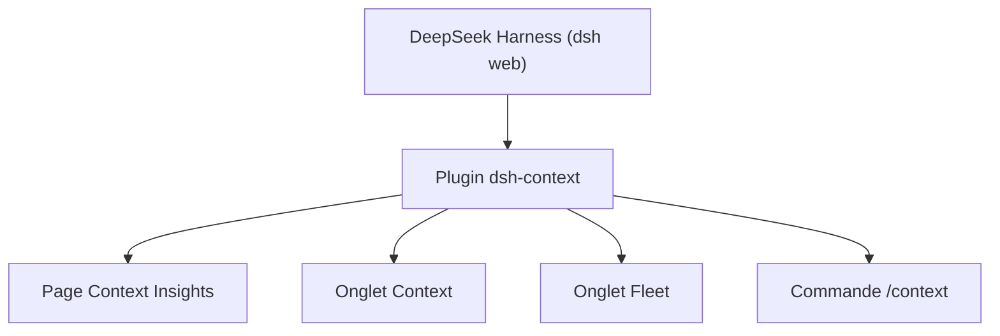

# bowenliang123/dsh-context

> DeepSeek Harness plugin that visualizes what an agent's context contains and what it costs.

## The problem
You can't tell what fills an agent's context window (system prompt, tools, results), nor when it is compacted, nor how many tokens it costs.

## What it actually does
Adds to the DeepSeek Harness interface an overview page (tokens, cost, cache rate, activity), a Context tab (composition, per-step trend, request browser, events, touched files, commands), a Fleet tab for subagents and a `/context` command. Cost is estimated from models.dev prices.

## How it is wired
Simplified diagram based on the sheet, no diagram provided.



## Trying it
```bash
dsh plugin --profile web add dsh-context
dsh plugin --profile web update dsh-context@latest
dsh web
```

## Cost and gotchas
Free, but you need DeepSeek Harness (version 0.2.0-rc.2 or later). Figures are estimates, with the provider's real values only when a step is pinned. README in Chinese.

## What it is not
Not usable without DeepSeek Harness, nor a monitor for other agents. The displayed costs are indicative, not an invoice.

## Alternatives
No alternative named in the README.

## For you
Worth watching: useful to diagnose context usage if you work with DeepSeek Harness, of no interest otherwise; a very recent project by a single author.
