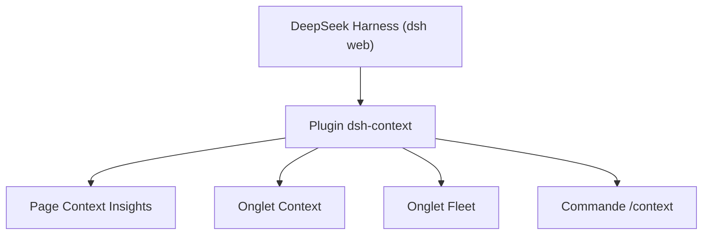

# bowenliang123/dsh-context

> Plugin de DeepSeek Harness qui visualise ce que contient le contexte d'un agent et ce qu'il coûte.

## Le problème
On ne sait pas ce qui remplit la fenêtre de contexte d'un agent (prompt système, outils, résultats), ni quand elle est compactée, ni combien de jetons cela coûte.

## Ce que ça fait vraiment
Ajoute à l'interface DeepSeek Harness une page de vue d'ensemble (jetons, coût, taux de cache, activité), un onglet Context (composition, tendance par étape, navigateur de requête, événements, fichiers touchés, commandes), un onglet Fleet pour les sous-agents et une commande `/context`. Le coût est estimé d'après les tarifs models.dev.

## Comment c'est branché
Schéma simplifié d'après la fiche, sans diagramme fourni.



## Essayer
```bash
dsh plugin --profile web add dsh-context
dsh plugin --profile web update dsh-context@latest
dsh web
```

## Coût et pièges
Gratuit, mais il faut DeepSeek Harness (version 0.2.0-rc.2 ou plus). Les chiffres sont des estimations, avec les valeurs réelles du fournisseur seulement quand une étape est épinglée. README en chinois.

## Ce que ce n'est pas
Pas un outil utilisable sans DeepSeek Harness, ni un moniteur pour d'autres agents. Les coûts affichés sont indicatifs, pas une facture.

## Alternatives
Aucune alternative nommée dans le README.

## Pour toi
À surveiller : utile pour diagnostiquer l'usage du contexte si tu travailles avec DeepSeek Harness, sans intérêt autrement ; projet très récent d'un seul auteur.

