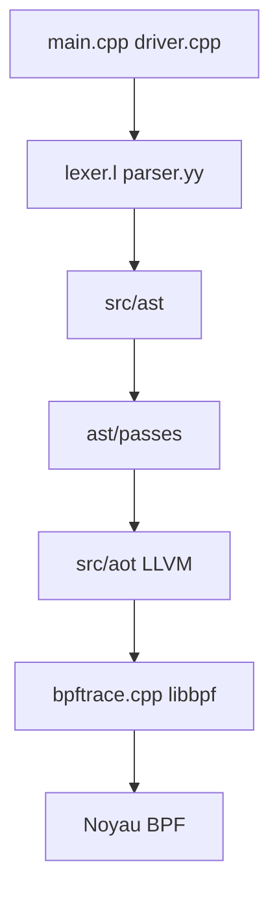

# bpftrace/bpftrace

> Linux tracing language and tool based on eBPF, for diagnosing the kernel and applications.

## The problem
Understanding why a Linux system is slow or misbehaving, without recompiling the kernel or adding load.

## What it actually does
Compiles short scripts (inspired by awk and C) into eBPF bytecode via LLVM, then loads them with libbpf. It attaches kernel probes (kprobes, perf events), user-space probes (USDT, uprobes) and tracepoints. The repository also ships ready-to-use tracing tools.

## How it is wired


## Trying it
```bash
sudo apt install bpftrace
sudo dnf install bpftrace
nix-shell -p bpftrace
bpftrace --version
```

## Cost and gotchas
Free. Linux only, with root privileges to load the probes. Check `bpftrace --version` before following the documentation of a different version.

## What it is not
Not a continuous monitoring tool, nor a cross-platform one: it is a one-off tracer for Linux.

## Alternatives
The tracers DTrace and SystemTap are mentioned as predecessors; the README names DTrace and SystemTap.

## For you
Worth watching: very useful in MLOps for diagnosing a Linux inference server, but best kept for system debugging moments.
