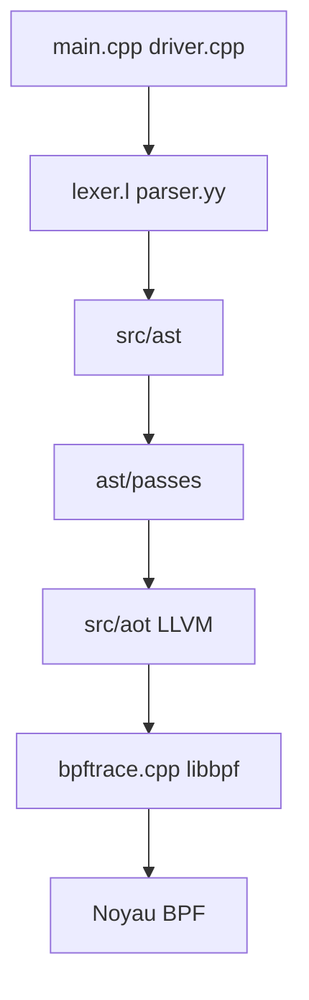

# bpftrace/bpftrace

> Langage et outil de traçage pour Linux basé sur eBPF, pour diagnostiquer noyau et applications.

## Le problème
Comprendre pourquoi un système Linux est lent ou se comporte mal, sans recompiler le noyau ni alourdir la charge.

## Ce que ça fait vraiment
Compile des scripts courts (inspirés d'awk et de C) en bytecode eBPF via LLVM, puis les charge avec libbpf. Il attache des sondes noyau (kprobes, événements perf), utilisateur (USDT, uprobes) et tracepoints. Le dépôt contient aussi des outils de traçage prêts à l'emploi.

## Comment c'est branché


## Essayer
```bash
sudo apt install bpftrace
sudo dnf install bpftrace
nix-shell -p bpftrace
bpftrace --version
```

## Coût et pièges
Gratuit. Linux uniquement, avec privilèges root pour charger les sondes. Vérifier `bpftrace --version` avant de suivre la documentation d'une autre version.

## Ce que ce n'est pas
Pas un outil de monitoring continu ni multiplateforme : c'est un traceur ponctuel pour Linux.

## Alternatives
Les traceurs DTrace et SystemTap sont évoqués comme prédécesseurs ; le README nomme DTrace et SystemTap.

## Pour toi
À surveiller : très utile en MLOps pour diagnostiquer un serveur d'inférence Linux, mais à garder pour les moments de débogage système.

