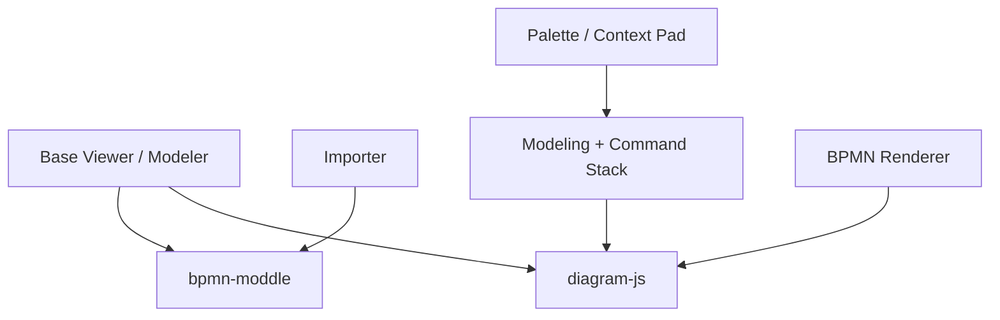

# bpmn-io/bpmn-js

> A BPMN 2.0 diagram viewer and editor for the browser, to embed process modelling in a web application.

## The problem
Displaying or editing BPMN business processes in a web application without writing a diagram rendering engine.

## What it actually does
Imports BPMN 2.0 XML, renders it in a page container and lets you edit it (palette, context menu, snapping, space tool, BPMN rules). Builds on `bpmn-moddle` (XML reading/writing) and `diagram-js` (rendering and editing). Extensible through modules.

## How it is wired


## Trying it
```bash
npm install
npm run all
npm start
npm run dev
```

## Cost and gotchas
Free. The license is present but not recognised by GitHub: read it before any commercial use. Some configuration is needed to build the latest development snapshot.

## What it is not
It is not a process execution engine: it draws and edits diagrams, it does not run them.

## Alternatives
No alternative named in the README.

## For you
Keep an eye on it: relevant only if you expose workflows (orchestration, validation) to business users in a web interface; check the license first.
