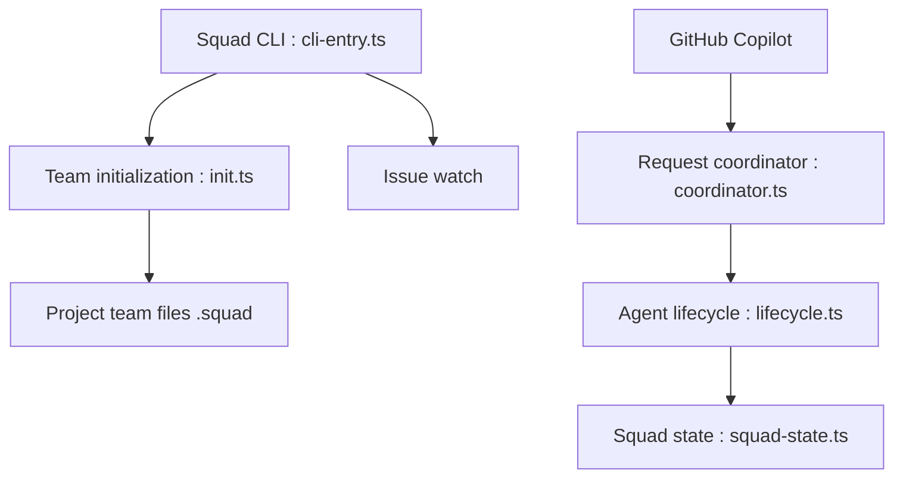

# bradygaster/squad

> Persistent, human-led team of AI agents that lives in your repository as files.

## The problem
Coding assistants forget everything from one session to the next and work alone, with no roles or shared decisions.

## What it actually does
`squad init` creates a `.squad/` folder: team, routing, decisions, charter and history for each agent. A coordinator splits the work among specialists (front, back, tests, lead) in parallel, through GitHub Copilot and other hosts (Claude Code, Cursor, Codex). The `watch` mode triages issues and can launch agents.

## How it is wired


## Trying it
```bash
npm install -g @bradygaster/squad-cli
squad init
gh auth login
copilot --agent squad --yolo
```

## Cost and gotchas
A GitHub Copilot subscription or another agent is required, and `gh` must be authenticated. `--yolo` removes tool confirmations. The SDK mode is announced as experimental; the interactive shell is deprecated.

## What it is not
Not a replacement for engineers: the human keeps priorities and validation. The README mentions "17 commands" but is truncated before the end.

## Alternatives
No alternative named in the README.

## For you
Worth watching: a useful idea of an agent team versioned in Git, but costly in calls and still experimental.
