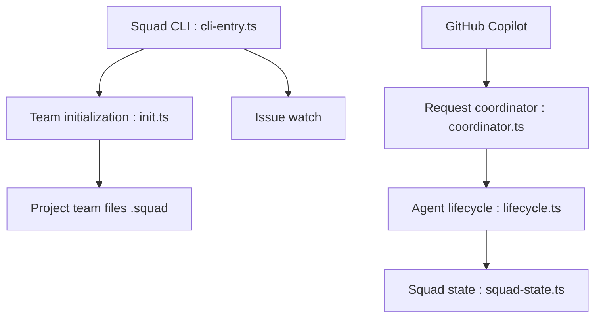

# bradygaster/squad

> Équipe d'agents IA persistante, dirigée par un humain, qui vit dans votre dépôt sous forme de fichiers.

## Le problème
Les assistants de code oublient tout d'une session à l'autre et travaillent seuls, sans rôles ni décisions partagées.

## Ce que ça fait vraiment
`squad init` crée un dossier `.squad/` : équipe, routage, décisions, charte et historique de chaque agent. Un coordinateur répartit le travail entre spécialistes (front, back, tests, lead) en parallèle, via GitHub Copilot et d'autres hôtes (Claude Code, Cursor, Codex). Le mode `watch` trie les tickets et peut lancer des agents.

## Comment c'est branché


## Essayer
```bash
npm install -g @bradygaster/squad-cli
squad init
gh auth login
copilot --agent squad --yolo
```

## Coût et pièges
Il faut un abonnement GitHub Copilot ou un autre agent, et `gh` authentifié. `--yolo` supprime les confirmations d'outils. Le mode SDK est annoncé expérimental ; le shell interactif est déprécié.

## Ce que ce n'est pas
Pas un remplaçant des ingénieurs : l'humain garde priorités et validation. Le README parle de « 17 commandes » mais est tronqué avant la fin.

## Alternatives
Aucune alternative nommée dans le README.

## Pour toi
À surveiller : idée utile d'équipe d'agents versionnée dans Git, mais coûteuse en appels et encore expérimentale.

