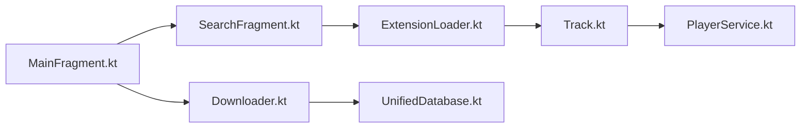

# brahmkshatriya/echo

> Android music player whose content sources come from extensions, for Android users.

## The problem
Music players are tied to a single catalogue; here the content depends on interchangeable modules.

## What it actually does
Android application: search and discovery via extensions loaded by `ExtensionLoader.kt`, playback by `PlayerService.kt`, downloads via `DownloadWorker.kt`/`Downloader.kt`, unified library in `UnifiedDatabase.kt`. The README states that the app hosts no content. Development is moving to a multiplatform version (Compose); the old version has to be looked for on Discord.

## How it is wired

## Trying it
No command documented in the README; the old version is obtained via the Discord server.

## Cost and gotchas
Free. External sources are the user's responsibility; the README reminds that the app is not affiliated with content providers.

## What it is not
Not a streaming service: without an extension, there is nothing to listen to. No installation documented in the README.

## Alternatives
No alternative named in the README.

## For you
Ignore: consumer Android application unrelated to data/AI/MLOps, licence to check and rewrite under way.
