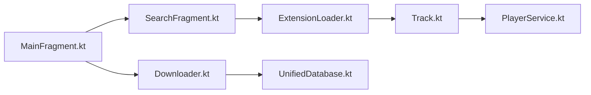

# brahmkshatriya/echo

> Lecteur de musique Android dont les sources de contenu viennent d'extensions, pour utilisateurs Android.

## Le problème
Les lecteurs musicaux sont liés à un seul catalogue ; ici le contenu dépend de modules interchangeables.

## Ce que ça fait vraiment
Application Android : recherche et découverte via des extensions chargées par `ExtensionLoader.kt`, lecture par `PlayerService.kt`, téléchargements via `DownloadWorker.kt`/`Downloader.kt`, bibliothèque unifiée dans `UnifiedDatabase.kt`. Le README précise que l'app n'héberge aucun contenu. Le développement se déplace vers une version multiplateforme (Compose) ; l'ancienne version est à chercher sur Discord.

## Comment c'est branché

## Essayer
Aucune commande documentée dans le README ; l'ancienne version se récupère via le serveur Discord.

## Coût et pièges
Gratuit. Les sources externes sont à la charge de l'utilisateur ; le README rappelle que l'app n'est pas affiliée aux fournisseurs de contenu.

## Ce que ce n'est pas
Pas un service de streaming : sans extension, rien à écouter. Pas d'installation documentée dans le README.

## Alternatives
Aucune alternative nommée dans le README.

## Pour toi
À ignorer : application grand public Android sans lien avec data/IA/MLOps, licence à vérifier et réécriture en cours.

