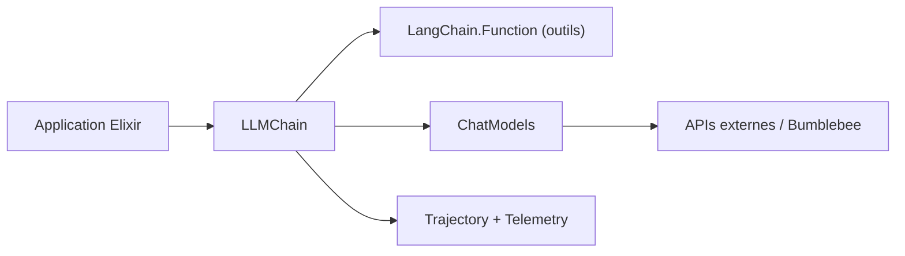

# brainlid/langchain

> Elixir library to integrate LLMs (Claude, OpenAI, Gemini, Ollama...) into an application, with tools and chains.

## The problem
Elixir applications have no idiomatic layer for talking to several LLM providers, calling functions and chaining messages.

## What it actually does
The core module `LLMChain` assembles messages, tools (`LangChain.Function`) and a model from about fifteen adapters: Anthropic, OpenAI, Responses API, xAI, Gemini, Vertex, DeepSeek, Ollama, Mistral, Bumblebee, OpenAI-compatible services. It adds streaming, multimodal content, `LangChain.Trajectory` to evaluate tool calls, and `:telemetry` instrumentation with optional OpenTelemetry export.

## How it is wired


## Trying it
```bash
# mix.exs : {:langchain, "~> 0.9.0"}
mix test
mix test --include live_call
```

## Cost and gotchas
One API key per provider (environment variables); the "live" tests make billable calls. Elixir 1.17 minimum. License not identified by GitHub.

## What it is not
Not a feature-parity port of LangChain Python/JS: the README says so openly. A repo under a single personal name.

## Alternatives
- LangChain Python or JS: the originals, broader (cited by the README).

## For you
Worth watching only if you work in Elixir; in Python, the original LangChain remains richer, and the license needs confirming.
