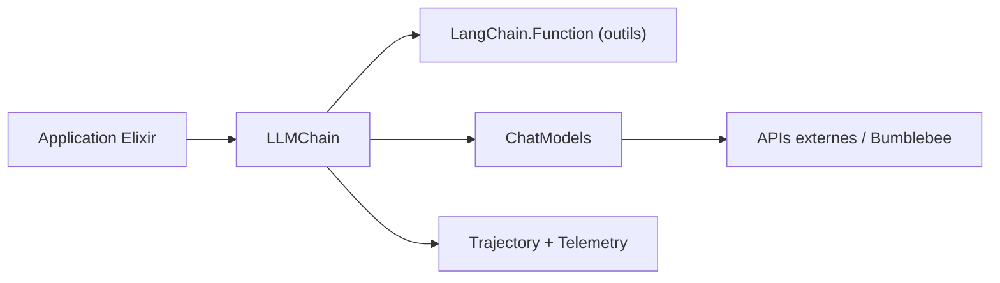

# brainlid/langchain

> Bibliothèque Elixir pour intégrer des LLM (Claude, OpenAI, Gemini, Ollama…) dans une application, avec outils et chaînes.

## Le problème
Les applications Elixir n'ont pas de couche idiomatique pour parler à plusieurs fournisseurs de LLM, appeler des fonctions et enchaîner les messages.

## Ce que ça fait vraiment
Le module central `LLMChain` assemble messages, outils (`LangChain.Function`) et un modèle parmi une quinzaine d'adaptateurs : Anthropic, OpenAI, Responses API, xAI, Gemini, Vertex, DeepSeek, Ollama, Mistral, Bumblebee, services compatibles OpenAI. Ajoute streaming, contenu multimodal, `LangChain.Trajectory` pour évaluer les appels d'outils, et télémétrie `:telemetry` avec export OpenTelemetry optionnel.

## Comment c'est branché


## Essayer
```bash
# mix.exs : {:langchain, "~> 0.9.0"}
mix test
mix test --include live_call
```

## Coût et pièges
Clé API par fournisseur (variables d'environnement) ; les tests « live » créent des appels facturables. Elixir 1.17 minimum. Licence non identifiée par GitHub.

## Ce que ce n'est pas
Pas un portage à parité de LangChain Python/JS : le README l'assume. Dépôt à nom propre unique.

## Alternatives
- LangChain Python ou JS : originaux, plus larges (cités par le README).

## Pour toi
À surveiller seulement si tu travailles en Elixir ; en Python, LangChain d'origine reste plus riche, et la licence est à confirmer.

