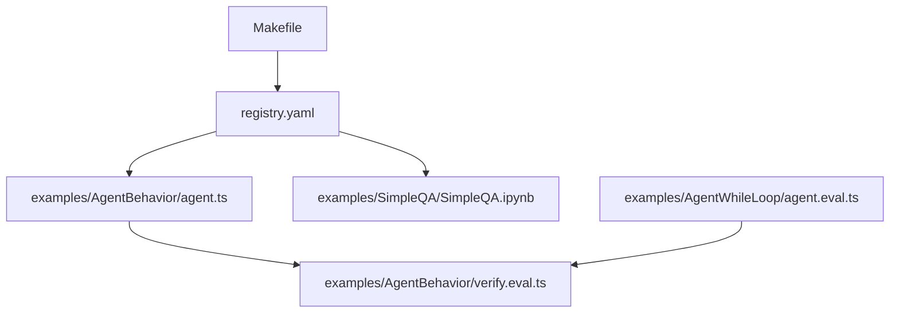

# braintrustdata/braintrust-cookbook

> Collection of language-model evaluation recipes with Braintrust, as notebooks, agents and applications.

## The problem
Evaluating an LLM or an agent calls for concrete examples rather than the tool's documentation alone.

## What it actually does
The README is empty; the description comes from the architecture. It contains notebooks (SimpleQA, Text2SQL), TypeScript agents with evaluations (AgentBehavior, AgentWhileLoop) and full applications (real-time RAG, Temporal deep research). A `registry.yaml` lists the examples and a Makefile supports them all.

## How it is wired

## Trying it
No command documented in the README.

## Cost and gotchas
A Braintrust account and model API keys are probably required (not documented). A license is present but not identified.

## What it is not
Not an installable tool: it is a collection of examples tied to the Braintrust platform.

## Alternatives
No alternative named in the README.

## For you
Worth watching: a source of LLM and agent evaluation examples useful to an AI profile, provided you accept Braintrust.
