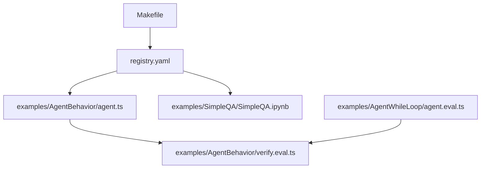

# braintrustdata/braintrust-cookbook

> Recueil de recettes d'évaluation de modèles de langage avec Braintrust, en notebooks, agents et applications.

## Le problème
Évaluer un LLM ou un agent demande des exemples concrets plutôt que la seule documentation de l'outil.

## Ce que ça fait vraiment
Le README est vide ; la description vient de l'architecture. On y trouve des notebooks (SimpleQA, Text2SQL), des agents TypeScript avec évaluations (AgentBehavior, AgentWhileLoop) et des applications complètes (RAG temps réel, recherche approfondie Temporal). Un `registry.yaml` liste les exemples et un Makefile outille le tout.

## Comment c'est branché

## Essayer
Aucune commande documentée dans le README.

## Coût et pièges
Un compte Braintrust et des clés d'API de modèles sont probablement nécessaires (non documenté). Licence présente mais non identifiée.

## Ce que ce n'est pas
Pas un outil installable : c'est un recueil d'exemples liés à la plateforme Braintrust.

## Alternatives
Aucune alternative nommée dans le README.

## Pour toi
À surveiller : source d'exemples d'évaluation de LLM et d'agents utile à un profil IA, à condition d'accepter Braintrust.

