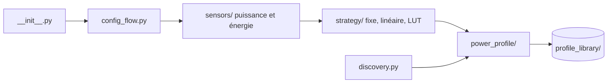

# bramstroker/homeassistant-powercalc

> Home Assistant integration that estimates the power consumption of devices without a meter, for home automation users.

## The problem
Lamps, fans and media players have no power measurement; installing a smart plug for each device is expensive.

## What it actually does
It creates virtual power sensors in Home Assistant, computed from the device state (brightness, color, speed), via strategies (fixed, linear, lookup table, multi-switch, playbook, WLED, composite). It relies on a library of per-model measured profiles, and adds energy sensors, cost sensors, utility meters and groups.

## How it is wired

## Trying it
No command documented in the README: it points to the Quick Start Guide and the online documentation.

## Cost and gotchas
Free. Requires a Home Assistant instance. Estimates are only as good as the measured profiles; devices absent from the library require manual configuration. An analytics component exists in the code, its nature is not detailed in the README.

## What it is not
Not a meter: these are estimates, not measurements. The README provided is short and details neither installation nor telemetry.

## Alternatives
No alternative named in the README.

## For you
Ignore: a home automation tool unrelated to a data/AI/MLOps profile; only the example of a library of measured profiles has curiosity value.
