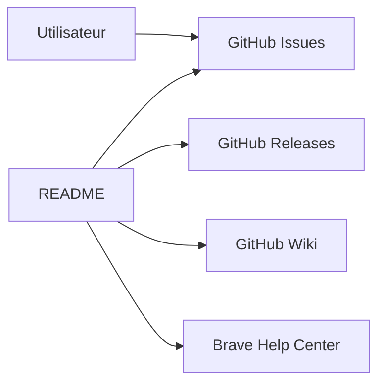

# brave/brave-browser

> Brave's gateway repository: issues, releases and wiki, without the browser's source code.

## The problem
Users and contributors need an entry point to report bugs and find published releases.

## What it actually does
The README says this repository is not needed to build the browser: it only contains the issues, the releases and the wiki. The code and contributions are in `brave/brave-core`. The README also points to a security policy and to the help center.

## How it is wired

## Trying it
No command documented.

## Cost and gotchas
Free. More than 10,000 open issues: this repository serves as a tracker, not as code to read or clone.

## What it is not
It is not the browser's code: that lives in `brave/brave-core`.

## Alternatives
No alternative named in the README (the code repository, `brave/brave-core`, is cited).

## For you
Ignore: a mere issues and releases portal, with no technical substance or link to data or AI.
