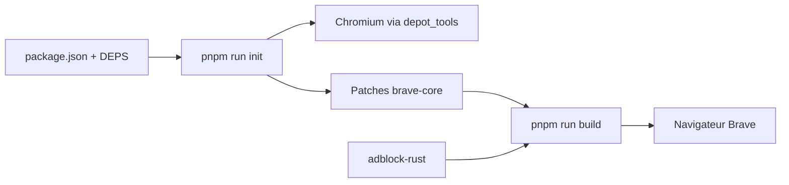

# brave/brave-core

> Set of modifications, APIs and scripts that turn Chromium into the Brave browser.

## The problem
Providing a privacy-focused browser requires maintaining patches on Chromium with every release.

## What it actually does
A build repository that fetches Chromium via `depot_tools`, mounted in `src/brave`, applies patches, syncs dependencies (adblock-rust included) and builds for desktop, Android and iOS. Visible features: search engine, wallet and DApps, Brave News, tab management, content blocking on iOS, local passage model.

## How it is wired


## Trying it
```bash
git clone git@github.com:brave/brave-core.git path-to-your-project-folder/src/brave
pnpm run init
pnpm run build
pnpm start
```

## Cost and gotchas
Free. Downloading Chromium means tens of GB, and building can take hours and a lot of RAM. Google Safe Browsing requires an API key. The cryptocurrency wallet is part of the code. MPL-2.0 license.

## What it is not
Not a ready-to-use browser: this is the build repository, downloads are on the website. Issues are tracked in `brave-browser`.

## Alternatives
No alternative named in the README.

## For you
Ignore: building a browser has no value for your work; install the released version if Brave interests you.
