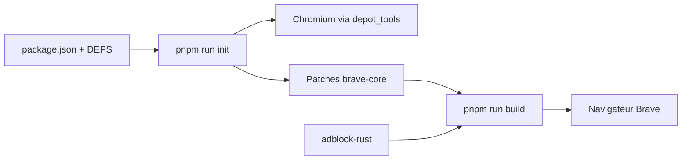

# brave/brave-core

> Ensemble de modifications, API et scripts qui transforment Chromium en navigateur Brave.

## Le problème
Fournir un navigateur centré sur la vie privée demande de maintenir des correctifs sur Chromium à chaque version.

## Ce que ça fait vraiment
Dépôt de construction qui récupère Chromium via `depot_tools`, monté dans `src/brave`, applique des correctifs, synchronise les dépendances (adblock-rust inclus) et compile pour bureau, Android et iOS. Fonctions visibles : moteur de recherche, portefeuille et DApps, Brave News, gestion d'onglets, blocage de contenu sur iOS, modèle de passages local.

## Comment c'est branché


## Essayer
```bash
git clone git@github.com:brave/brave-core.git path-to-your-project-folder/src/brave
pnpm run init
pnpm run build
pnpm start
```

## Coût et pièges
Gratuit. Télécharger Chromium représente des dizaines de Go, la compilation peut durer des heures et beaucoup de RAM. Google Safe Browsing demande une clé d'API. Le portefeuille de crypto-monnaies fait partie du code. Licence MPL-2.0.

## Ce que ce n'est pas
Pas un navigateur prêt à utiliser : c'est le dépôt de construction, les téléchargements sont sur le site. Les issues sont suivies dans `brave-browser`.

## Alternatives
Aucune alternative nommée dans le README.

## Pour toi
Ignorer : compiler un navigateur n'a pas d'intérêt pour ton travail ; installe la version publiée si Brave t'intéresse.

