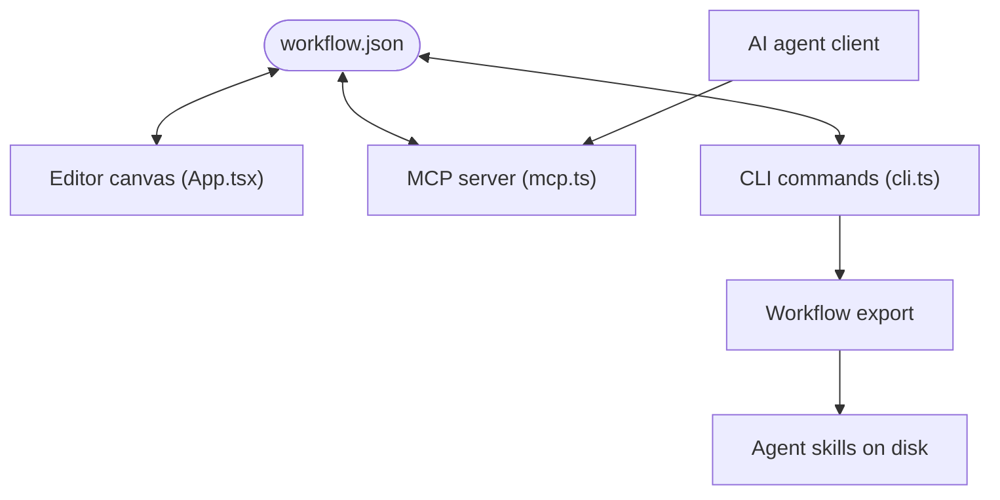

# breaking-brake/cc-wf-studio

> Visual editor for AI agent workflows, exported as Markdown, for VS Code and Claude Code users.

## The problem
Describing agent orchestrations by hand in prompts quickly becomes unreadable and hard to validate.

## What it actually does
A drag-and-drop canvas draws a workflow saved as `workflow.json`. The same file is read by the VS Code extension, a `ccwf` CLI (render, validate, export, run, preview) and a `ccwf-mcp` MCP server. The export produces slash commands or agent skills (`.claude/`, `.codex/`, `.cursor/`). An "Edit with AI" mode modifies the workflow in natural language. Slack sharing is available.

## How it is wired


## Trying it
```bash
code --install-extension breaking-brake.cc-wf-studio
npx @cc-wf-studio/cli --help
```

## Cost and gotchas
Free, but execution and AI editing go through your agent and its credits. The README's examples section is announced as "coming soon".

## What it is not
Not an autonomous execution engine: it generates files for existing agents. Examples and tutorials are not published yet.

## Alternatives
No alternative named in the README (Dify is cited as an inspiration).

## For you
Worth watching: handy for designing agent orchestrations visually, but the license needs checking and examples are missing.
