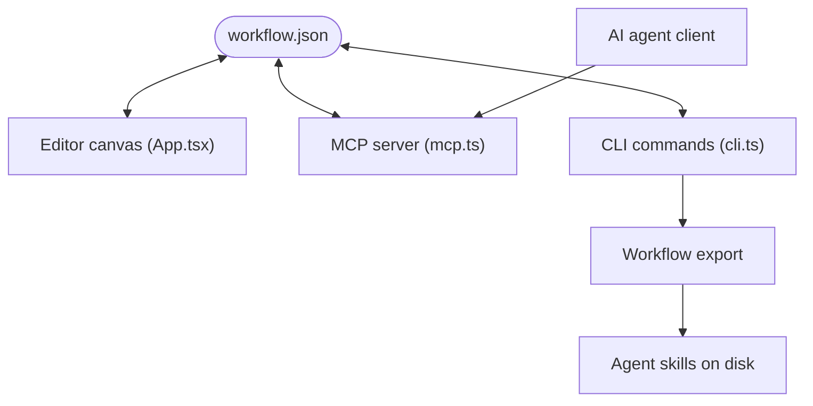

# breaking-brake/cc-wf-studio

> Éditeur visuel de workflows d'agents IA, exportés en Markdown, pour utilisateurs de VS Code et de Claude Code.

## Le problème
Décrire à la main des orchestrations d'agents en prompts devient vite illisible et difficile à valider.

## Ce que ça fait vraiment
Un canevas à glisser-déposer dessine un workflow enregistré en `workflow.json`. Le même fichier est lu par l'extension VS Code, une CLI `ccwf` (render, validate, export, run, preview) et un serveur MCP `ccwf-mcp`. L'export produit des commandes slash ou skills d'agents (`.claude/`, `.codex/`, `.cursor/`). Un mode « Edit with AI » modifie le workflow en langage naturel. Un partage Slack existe.

## Comment c'est branché


## Essayer
```bash
code --install-extension breaking-brake.cc-wf-studio
npx @cc-wf-studio/cli --help
```

## Coût et pièges
Gratuit, mais l'exécution et l'édition par IA passent par ton agent et ses crédits. La rubrique d'exemples du README est annoncée « bientôt ».

## Ce que ce n'est pas
Pas un moteur d'exécution autonome : il génère des fichiers pour des agents existants. Les exemples et tutoriels ne sont pas encore publiés.

## Alternatives
Aucune alternative nommée dans le README (Dify est cité comme inspiration).

## Pour toi
À surveiller : pratique pour concevoir des orchestrations d'agents visuellement, mais licence à vérifier et exemples absents.

